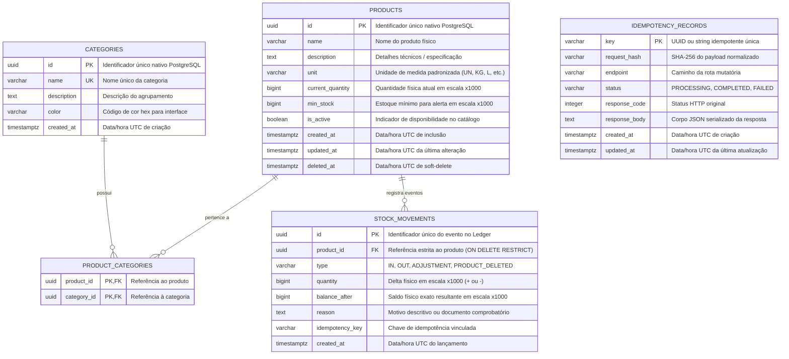
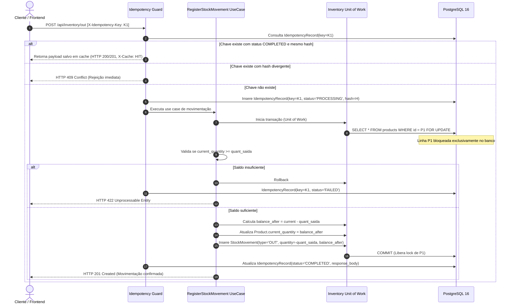

# Especificação Técnica de Backend (BACKEND_SPEC)
## Arquitetura, Banco de Dados, Transações e Migrações

---

## 1. Visão Geral da Arquitetura

O backend do sistema de estoque é projetado em **Clean Architecture Modular** utilizando **Python 3.12**, **FastAPI**, **SQLAlchemy 2.0 (Declarative)** e **Alembic**, operando sobre **PostgreSQL 16**.

### 1.1. Princípios Arquiteturais Inegociáveis
1. **Isolamento de Domínio:** A lógica de negócio essencial (cálculo de deltas de estoque, validação de saldo não-negativo, invariantes contábeis) é independente de frameworks web e drivers de persistência.
2. **PostgreSQL Exclusivo:** Todo o código de produção conecta-se exclusivamente ao PostgreSQL 16 (containerizado via Docker Compose). Menções ou fallbacks para SQLite em código de produção são estritamente proibidos.
3. **Escala Inteira Fixa ($10^3$):** Quantidades fracionárias são computadas e persistidas estritamente como `BIGINT` escalados por 1.000, eliminando tipos `FLOAT`.
4. **Livro-Razão (Ledger) Imutável:** A tabela `stock_movements` não permite operações de `UPDATE` ou `DELETE`. Todas as transações no estoque são adições cronológicas (*Append-Only*).
5. **Idempotência no Backend (RFC 9474):** O backend valida a intenção da requisição via hash semântico SHA-256 e gerencia atomicamente o ciclo de vida da chave de idempotência com controle de concorrência.
6. **Controle de Concorrência Pessimista:** Atualizações no saldo de produtos e emissão de movimentações exigem bloqueio de linha explícito no banco (`SELECT ... FOR UPDATE`).
7. **Versionamento Estrito por Migrações:** O esquema de banco é gerido exclusivamente via **Alembic**. O método `Base.metadata.create_all()` é banido de ambientes de produção.

---

## 2. Estrutura Modular de Pastas

A estrutura modular organiza responsabilidades por capacidade de negócio, contendo cada módulo suas camadas de Domínio, Aplicação, Infraestrutura e Interfaces:

```text
backend/
├── alembic/                         # Configurações e scripts de migração Alembic
│   ├── versions/                    # Arquivos versionados de migração (0001_initial_schema.py, ...)
│   ├── env.py                       # Configuração de contexto e metadados SQLAlchemy
│   └── script.py.mako               # Template gerador de novas migrações
├── alembic.ini                      # Arquivo de configuração de ambiente do Alembic
├── app/
│   ├── core/                        # Configurações globais e inicialização de ambiente
│   │   ├── __init__.py
│   │   └── config.py                # Configurações via pydantic-settings (.env)
│   ├── shared/                      # Elementos transversais reutilizáveis
│   │   ├── domain/                  # Value Objects compartilhados e exceptions base
│   │   │   ├── __init__.py
│   │   │   └── exceptions.py
│   │   ├── infrastructure/          # Conexão de banco e SQLAlchemy Base
│   │   │   ├── __init__.py
│   │   │   └── database.py          # PostgreSQL 16 Engine e SessionLocal (Sem SQLite)
│   │   └── utils/                   # Conversores utilitários
│   │       ├── __init__.py
│   │       └── scale.py             # Conversão bidirecional de escala x1000
│   ├── modules/
│   │   ├── idempotency/             # Módulo de Idempotência e Tolerância a Falhas
│   │   │   ├── domain/
│   │   │   │   ├── __init__.py
│   │   │   │   ├── entities.py      # Entidade IdempotencyRecord
│   │   │   │   └── repositories.py  # Interface IIdempotencyRepository
│   │   │   ├── infrastructure/
│   │   │   │   ├── __init__.py
│   │   │   │   ├── models.py        # Modelo SQLAlchemy nativo Postgres
│   │   │   │   └── repositories.py  # Implementação Postgres do repositório
│   │   │   └── interfaces/
│   │   │       ├── __init__.py
│   │   │       ├── hasher.py        # Normalizador de requisição e gerador SHA-256
│   │   │       └── guard.py         # Dependency FastAPI / Interceptor de Idempotência
│   │   ├── products/                # Módulo de Catálogo e Categorias
│   │   │   ├── domain/
│   │   │   │   ├── __init__.py
│   │   │   │   ├── entities.py      # Product, Category
│   │   │   │   └── repositories.py  # IProductRepository, ICategoryRepository
│   │   │   ├── application/
│   │   │   │   ├── __init__.py
│   │   │   │   ├── dtos.py          # Schemas Pydantic v2 (Input/Output)
│   │   │   │   └── use_cases.py     # CreateProduct, SoftDeleteProduct, etc.
│   │   │   ├── infrastructure/
│   │   │   │   ├── __init__.py
│   │   │   │   ├── models.py        # Modelos ORM: Product, Category, product_categories
│   │   │   │   └── repositories.py  # Implementação concreta dos repositórios
│   │   │   └── interfaces/
│   │   │       ├── __init__.py
│   │   │       └── router.py        # Endpoints RESTful de Produtos e Categorias
│   │   └── inventory/               # Módulo do Livro-Razão (Ledger)
│   │       ├── domain/
│   │       │   ├── __init__.py
│   │       │   ├── entities.py      # StockMovement, MovementType Enum
│   │       │   ├── exceptions.py    # InsufficientStockError, InvalidMovementError
│   │       │   └── repositories.py  # IStockMovementRepository, IInventoryUnitOfWork
│   │       ├── application/
│   │       │   ├── __init__.py
│   │       │   ├── dtos.py          # Schemas Pydantic v2 (MovementInput, MovementOutput)
│   │       │   └── use_cases.py     # RegisterStockMovementUseCase, GetLedgerUseCase
│   │       ├── infrastructure/
│   │       │   ├── __init__.py
│   │       │   ├── models.py        # Modelo ORM: StockMovement (Append-Only)
│   │       │   ├── repositories.py  # StockMovementRepository
│   │       │   └── unit_of_work.py  # Implementação do Unit of Work com locks
│   │       └── interfaces/
│   │           ├── __init__.py
│   │           └── router.py        # Endpoints de Entrada, Saída, Ajuste e Extrato
│   └── main.py                      # FastAPI App, montagem de rotas e lifecycle
├── tests/
│   ├── conftest.py                  # Fixtures com PostgreSQL isolado para testes
│   ├── test_idempotency.py          # Testes de replay, conflito 409 e locks concorrentes
│   ├── test_products.py             # Testes de catálogo e categorização N:N
│   └── test_inventory_ledger.py     # Testes de concorrência, saldo e imutabilidade
├── docker-compose.yml               # Container oficial do PostgreSQL 16
├── requirements.txt                 # Dependências exatas (FastAPI, Alembic, psycopg2...)
└── .env.example
```

---

## 3. Modelo de Dados e Esquema Físico (PostgreSQL 16)

### 3.1. Diagrama Entidade-Relacionamento (ERD)



### 3.2. Regras de Tipagem e Restrições Físicas do Banco
- **Chaves Primárias:** Colunas `id` utilizam tipo nativo `UUID` do PostgreSQL (`postgresql.UUID(as_uuid=True)`), geradas por padrão no backend via `uuid.uuid4()`.
- **Datas e Timestamps:** Todas as colunas temporais utilizam `TIMESTAMP WITH TIME ZONE` (`DateTime(timezone=True)`). O backend padroniza armazenamento exclusivo em `UTC` (`datetime.now(timezone.utc)`).
- **Quantidades Aritméticas:** Armazenadas obrigatoriamente como inteiros de 64 bits (`BIGINT`), garantindo capacidade para representar volumes industriais em escala $10^3$ sem risco de transbordamento de memória (*integer overflow*).
- **Integridade Referencial do Ledger:** A chave estrangeira `stock_movements.product_id` adota a regra `ON DELETE RESTRICT`. Uma vez existindo lançamentos no Ledger, o banco de dados rejeita fisicamente qualquer comando de `DELETE` acidental sobre a tabela `products`.
- **Imutabilidade e Append-Only:** A integridade do Ledger é garantida pela ausência de rotinas de alteração/exclusão na camada de repositório e pelo uso de soft-delete com lançamento do evento `PRODUCT_DELETED`.

---

## 4. Gerenciamento de Migrações com Alembic

### 4.1. Configuração do Alembic
O projeto adota o **Alembic** integrado ao SQLAlchemy declarativo:
- O arquivo `alembic.ini` aponta para a pasta `alembic/` dentro de `backend/`.
- O arquivo `backend/alembic/env.py` importa o `Base.metadata` que agrupa todos os modelos do sistema (`Product`, `Category`, `product_categories`, `StockMovement`, `IdempotencyRecord`) e obtém a URL de conexão diretamente da classe de configurações de produção `app.core.config.settings.DATABASE_URL`.
- O método de inicialização `Base.metadata.create_all()` **não é executado** na subida do container nem na inicialização do FastAPI (`main.py`).

### 4.2. Fluxo Operacional de Migração
1. **Geração da Migração Inicial:**
   ```bash
   alembic revision --autogenerate -m "0001_initial_schema"
   ```
2. **Revisão Humana do Código SQL/Alembic:**
   O arquivo gerado em `backend/alembic/versions/` é inspecionado para assegurar que os tipos nativos (`postgresql.UUID`, `TIMESTAMP WITH TIME ZONE`, `BIGINT`, constraints `RESTRICT`) foram corretamente detectados.
3. **Aplicação das Migrações:**
   ```bash
   alembic upgrade head
   ```

---

## 5. Padrão Unit of Work e Bloqueio Concorrente Pessimista

### 5.1. O Problema da Concorrência em Estoque
Se duas requisições concorrentes tentarem baixar 5 unidades de um produto que possui apenas 8 unidades em estoque:
1. Ambas leem `current_quantity = 8`.
2. Ambas validam que $8 \ge 5$.
3. A requisição A grava saldo 3. A requisição B sobrescreve gravando saldo 3 (ou o estoque vai para -2 se ambos decrementarem sem isolamento).

### 5.2. Solução: Unit of Work com `SELECT ... FOR UPDATE`
O sistema resolve essa condição de corrida através do padrão **Unit of Work (UoW)** combinado com **bloqueio pessimista de linha** (`pessimistic locking`):

```python
# Padrão transacional seguro com lock pessimista no produto:
class InventoryUnitOfWork:
    def __init__(self, session_factory):
        self.session_factory = session_factory

    def __enter__(self):
        self.session = self.session_factory()
        self.products = ProductRepository(self.session)
        self.movements = StockMovementRepository(self.session)
        return self

    def __exit__(self, exc_type, exc_val, exc_tb):
        if exc_type:
            self.session.rollback()
        else:
            self.session.commit()
        self.session.close()

    def get_product_for_update(self, product_id: uuid.UUID) -> Product:
        # Emite: SELECT * FROM products WHERE id = :id FOR UPDATE
        return self.session.query(Product).filter(
            Product.id == product_id,
            Product.is_active == True
        ).with_for_update().first()
```

### 5.3. Sequência de Execução de Movimentação



---

## 6. Especificação do Módulo de Idempotência (RFC 9474)

### 6.1. Protocolo HTTP e Cabeçalhos
- Cabeçalho de entrada obrigatório em operações mutatórias críticas:
  `X-Idempotency-Key: <UUIDv4>`
- Cabeçalhos de resposta emitidos pelo backend:
  - `X-Idempotency-Key: <UUIDv4>`
  - `X-Cache: HIT` (quando a resposta é fruto de repetição idempotente com replay de cache)
  - `X-Cache: MISS` (quando a resposta foi processada e computada originalmente)

### 6.2. Cálculo do Hash Semântico SHA-256
Para assegurar que o cliente não reutilizou a mesma chave para uma intenção de negócio diferente:
1. O corpo JSON da requisição é desserializado e resserializado com chaves ordenadas (*canonical JSON*), eliminando variações de espaçamento em branco:
   $$\text{canonical\_payload} = \text{json.dumps}(payload, \text{sort\_keys}=\text{True}, \text{separators}=(',', ':'))$$
2. A string composta para o cálculo do digest é:
   $$\text{input\_string} = \text{METHOD} + "|" + \text{PATH} + "|" + \text{canonical\_payload}$$
3. O hash final é gerado em representação hexadecimal de 64 caracteres:
   $$\text{request\_hash} = \text{SHA256}(\text{input\_string})$$

### 6.3. Tabela de Estados e Respostas
| Estado Atual no Banco | Hash Recebido | Ação do Backend | Código HTTP de Retorno |
| :--- | :--- | :--- | :--- |
| Inexistente | Qualquer | Cria registro como `PROCESSING`, executa o Use Case e comita como `COMPLETED`. | `201 Created` / `200 OK` (`X-Cache: MISS`) |
| `PROCESSING` | Qualquer | Detecta requisição concorrente em andamento para a mesma chave. | `409 Conflict` (ou `425 Too Early`) |
| `COMPLETED` | **Idêntico** | Retransmissão legítima. Lê resposta arquivada e faz replay. | Código original salvo (`X-Cache: HIT`) |
| `COMPLETED` | **Diferente** | Tentativa de colisão ou fraude de chave para payload diferente. | `409 Conflict` com detalhes RFC 7807 |
| `FAILED` | Idêntico | Transação original falhou. Permite retentativa ou reexecução. | Executa nova tentativa ou retorna erro |

---

## 7. Contrato Detalhado de Endpoints da API RESTful

Todas as rotas da API são prefixadas com `/api`.

### 7.1. Módulo de Produtos (`/api/products`)

#### 1. `POST /api/products` (Criação de Produto)
- **Headers:** `X-Idempotency-Key` (Recomendado).
- **Request Body:**
  ```json
  {
    "name": "Resina Epóxi Industrial",
    "description": "Componente bicomponente para vedação",
    "unit": "KG",
    "min_stock": 5.0,
    "category_ids": [
      "d73b064c-3571-47a3-b4cf-51c09930965e",
      "e22b064c-3571-47a3-b4cf-51c09930965f"
    ]
  }
  ```
- **Processamento:** Converte `min_stock` de `5.0` para `5000` (`BIGINT`).
- **Response `201 Created`:**
  ```json
  {
    "id": "84be20c8-7ea1-4cb3-9112-a16f6b579178",
    "name": "Resina Epóxi Industrial",
    "description": "Componente bicomponente para vedação",
    "unit": "KG",
    "current_quantity_raw": 0,
    "current_quantity": 0.0,
    "formatted_quantity": "0,000 KG",
    "min_stock_raw": 5000,
    "min_stock": 5.0,
    "is_low_stock": true,
    "is_active": true,
    "categories": [
      {
        "id": "d73b064c-3571-47a3-b4cf-51c09930965e",
        "name": "Químicos",
        "color": "#10B981"
      }
    ],
    "created_at": "2026-11-10T16:00:00Z",
    "updated_at": "2026-11-10T16:00:00Z"
  }
  ```

#### 2. `GET /api/products` (Listagem com Filtros)
- **Query Params:**
  - `category_id` (opcional, UUID): Filtra por categoria.
  - `low_stock_only` (opcional, boolean): Retorna apenas itens onde `is_low_stock == True`.
  - `search` (opcional, string): Busca textual por nome ou descrição.
  - `include_inactive` (opcional, boolean, default `false`): Exibe itens inativados.
  - `limit` (int, default 50), `offset` (int, default 0).
- **Response `200 OK`:** Lista paginada de produtos com cálculo dinâmico de `is_low_stock`.

#### 3. `GET /api/products/{id}` (Detalhe do Produto)
- **Response `200 OK`:** Objeto do produto com detalhes cadastrais, saldo atual e categorias vinculadas.
- **Response `404 Not Found`:** Se o produto não existir.

#### 4. `PUT /api/products/{id}` (Edição Cadastral)
- **Request Body:** Atualização de nome, descrição, unidade, estoque mínimo e categorias vinculadas. Saldo físico **não pode** ser alterado por este endpoint.
- **Response `200 OK`:** Objeto atualizado.

#### 5. `DELETE /api/products/{id}` (Soft-Delete com Evento Contábil)
- **Headers:** `X-Idempotency-Key` (Obrigatório).
- **Request Body:**
  ```json
  {
    "reason": "Descontinuação do insumo pelo fabricante"
  }
  ```
- **Processamento:**
  - Obtém lock pessimista.
  - Marca `is_active = False` e `deleted_at = NOW()`.
  - Grava evento no Ledger: `type = "PRODUCT_DELETED"`, `quantity = 0`, `balance_after = current_balance`, `reason = reason`.
- **Response `200 OK`:** Mensagem de confirmação e status inativo.

---

### 7.2. Módulo de Categorias (`/api/categories`)

#### 1. `GET /api/categories`
- **Response `200 OK`:** Lista de todas as categorias cadastradas, ordenadas por nome.

#### 2. `POST /api/categories`
- **Request Body:** `{"name": "Embalagens", "description": "Caixas e fitas", "color": "#F59E0B"}`.
- **Response `201 Created`:** Categoria persistida.

#### 3. `DELETE /api/categories/{id}`
- **Response `204 No Content`:** Exclui a categoria e seus vínculos associativos na tabela `product_categories`, sem afetar os produtos.

---

### 7.3. Módulo de Livro-Razão de Estoque (`/api/inventory`)

#### 1. `POST /api/inventory/in` (Entrada Física de Estoque)
- **Headers:** `X-Idempotency-Key: <UUIDv4>` (Obrigatório).
- **Request Body:**
  ```json
  {
    "product_id": "84be20c8-7ea1-4cb3-9112-a16f6b579178",
    "quantity": 12.5,
    "reason": "Recebimento Fornecedor - NF 10429"
  }
  ```
- **Processamento:**
  - Valida idempotência.
  - Converte `12.5` para `12500`.
  - Trava a linha do produto no PostgreSQL (`SELECT ... FOR UPDATE`).
  - Calcula `balance_after = current_quantity + 12500`.
  - Atualiza produto e grava linha no `stock_movements` com `type = "IN"`.
- **Response `201 Created`:**
  ```json
  {
    "movement_id": "314f8ca2-563b-4861-bca9-05206c9bcfa1",
    "product_id": "84be20c8-7ea1-4cb3-9112-a16f6b579178",
    "type": "IN",
    "delta_raw": 12500,
    "delta": 12.5,
    "balance_after_raw": 12500,
    "balance_after": 12.5,
    "unit": "KG",
    "reason": "Recebimento Fornecedor - NF 10429",
    "created_at": "2026-11-10T16:05:00Z"
  }
  ```

#### 2. `POST /api/inventory/out` (Saída Física de Estoque)
- **Headers:** `X-Idempotency-Key: <UUIDv4>` (Obrigatório).
- **Request Body:**
  ```json
  {
    "product_id": "84be20c8-7ea1-4cb3-9112-a16f6b579178",
    "quantity": 5.0,
    "reason": "Requisição de produção - Lote 884"
  }
  ```
- **Processamento:**
  - Trava a linha do produto com `SELECT ... FOR UPDATE`.
  - Se `current_quantity < 5000`, lança erro e responde `422 Unprocessable Entity`:
    ```json
    {
      "type": "https://api.estoque.local/errors/insufficient-stock",
      "title": "Saldo de estoque insuficiente",
      "status": 422,
      "detail": "O produto possui saldo disponível de 3,000 KG, insuficiente para a saída solicitada de 5,000 KG."
    }
    ```
  - Se houver saldo suficiente, subtrai `5000` de `current_quantity` e grava no Ledger com `quantity = -5000`.
- **Response `201 Created`:** Detalhes da movimentação e novo saldo.

#### 3. `POST /api/inventory/adjustment` (Ajuste Físico de Inventário)
- **Headers:** `X-Idempotency-Key: <UUIDv4>` (Obrigatório).
- **Request Body:**
  ```json
  {
    "product_id": "84be20c8-7ea1-4cb3-9112-a16f6b579178",
    "new_quantity": 8.0,
    "reason": "Contagem física do inventário mensal - Regularização de sobra"
  }
  ```
- **Processamento:**
  - Lock pessimista na linha do produto.
  - Obtém `Q_atual = 7500`.
  - Converte `new_quantity = 8.0` para `Q_novo = 8000`.
  - Calcula $\Delta = 8000 - 7500 = +500$.
  - Atualiza `Product.current_quantity = 8000`.
  - Grava no Ledger com `type = "ADJUSTMENT"`, `quantity = 500`, `balance_after = 8000`.
- **Response `201 Created`:** Resumo do ajuste com o delta apurado.

#### 4. `GET /api/inventory/movements` (Extrato Global do Ledger)
- **Query Params:**
  - `product_id` (opcional, UUID)
  - `type` (opcional: `IN`, `OUT`, `ADJUSTMENT`, `PRODUCT_DELETED`)
  - `start_date` (opcional, ISO 8601 UTC)
  - `end_date` (opcional, ISO 8601 UTC)
  - `limit` (int, default 50), `offset` (int, default 0)
- **Response `200 OK`:** Lista paginada em ordem cronológica decrescente (`created_at DESC`), contendo todos os campos do Ledger para auditoria irrefutável.

---

### 7.4. Healthcheck (`/api/health`)
- **`GET /api/health`**
- **Response `200 OK`:**
  ```json
  {
    "status": "healthy",
    "database": "postgresql",
    "version": "1.0.0",
    "quantity_scale": 1000
  }
  ```

---

## 8. Tratamento de Erros e Padrão RFC 7807

O backend utiliza o padrão **RFC 7807 (Problem Details for HTTP APIs)** para todas as respostas de erro:

```json
{
  "type": "https://api.estoque.local/errors/idempotency-conflict",
  "title": "Conflito de Idempotência",
  "status": 409,
  "detail": "A chave de idempotência 'a76b...' já foi utilizada anteriormente com um corpo ou rota diferente.",
  "instance": "/api/inventory/out"
}
```

Códigos de erro padronizados:
- `400 Bad Request`: Payload sintaticamente inválido ou campos ausentes.
- `404 Not Found`: Recurso não localizado (produto ou categoria inexistente).
- `409 Conflict`: Conflito de idempotência ou tentativa concorrente na mesma chave.
- `422 Unprocessable Entity`: Regra de negócio violada (ex: saldo insuficiente para saída).
- `500 Internal Server Error`: Falha interna inesperada capturada pelo middleware global.
