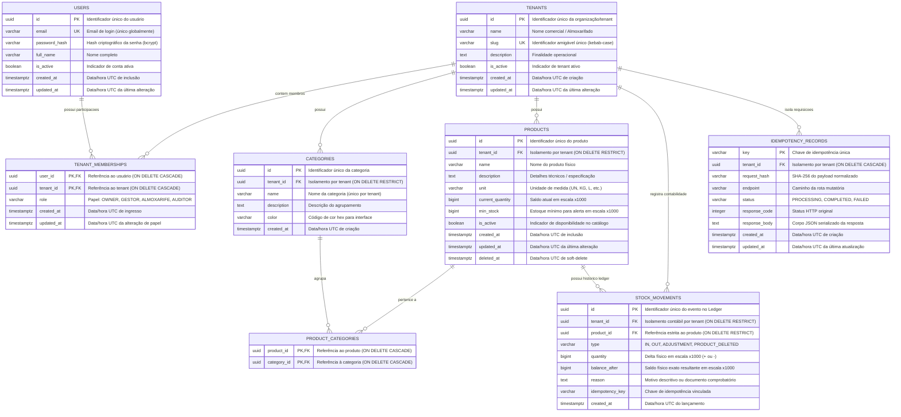
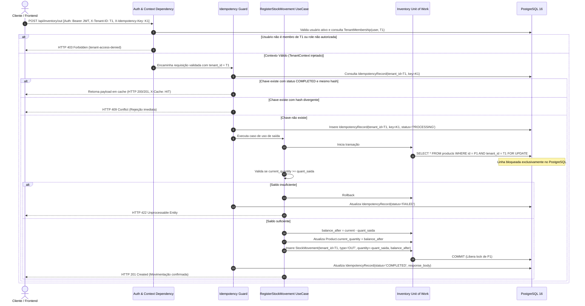

# Especificação Técnica de Backend (BACKEND_SPEC)
## Arquitetura, Banco de Dados, Multi-Tenancy, Autenticação e Transações

---

## 1. Visão Geral da Arquitetura

O backend do sistema de estoque é projetado em **Clean Architecture Modular** utilizando **Python 3.12**, **FastAPI**, **SQLAlchemy 2.0 (Declarative)** e **Alembic**, operando exclusivamente sobre **PostgreSQL 16**. A plataforma implementa arquitetura **SaaS B2B Multi-Tenant**, com isolamento lógico estrito entre organizações, controle de acesso baseado em papéis (RBAC) e Livro-Razão Contábil Perpétuo (*Append-Only Ledger*).

### 1.1. Princípios Arquiteturais Inegociáveis
1. **Isolamento de Domínio:** A lógica de negócio essencial (cálculo de deltas de estoque, validação de saldo não-negativo, invariantes contábeis) é independente de frameworks web e drivers de persistência.
2. **PostgreSQL Exclusivo:** Todo o código de produção conecta-se unicamente ao PostgreSQL 16 (containerizado via Docker Compose). Menções ou fallbacks para SQLite em código de produção são estritamente proibidos.
3. **Multi-Tenancy e Isolamento Estrito de Dados:** Cada tenant representa uma organização/empresa ou almoxarifado independente. Todas as entidades de catálogo, inventário e idempotência possuem obrigatoriamente um `tenant_id` (`UUID` nativo com `NOT NULL`). Nenhuma consulta ou mutação pode cruzar as fronteiras do tenant ativo.
4. **Identidade Centralizada e Relação N:N Usuário-Tenant:** Usuários possuem identidade global única (email único) e podem participar de múltiplos tenants via tabela associativa (`tenant_memberships`), exercendo papéis granulares (`OWNER`, `GESTOR`, `ALMOXARIFE`, `AUDITOR`).
5. **Autenticação Segura JWT e Contexto de Execução:** Autenticação stateless via OAuth2 Password Bearer gerando tokens JWT (RFC 7519) assinados com `HS256`. Senhas salgadas e criptografadas com `passlib[bcrypt]` (mínimo 12 rounds) ou `argon2`. Rotas protegidas exigem o cabeçalho `X-Tenant-ID`, validado atomicamente contra as permissões do usuário logado.
6. **Criação Autônoma de Tenant:** Qualquer usuário autenticado pode criar um novo tenant, tornando-se instantaneamente seu `OWNER` de forma transacionalmente atômica.
7. **Escala Inteira Fixa ($10^3$):** Quantidades fracionárias são computadas e persistidas estritamente como `BIGINT` escalados por 1.000, eliminando tipos `FLOAT` do domínio e banco de dados.
8. **Livro-Razão (Ledger) Imutável:** A tabela `stock_movements` não permite operações de `UPDATE` ou `DELETE`. Todas as transações no estoque são adições cronológicas (*Append-Only*) segregadas por tenant.
9. **Idempotência no Backend (RFC 9474):** O backend valida a intenção da requisição via hash semântico SHA-256 e gerencia atomicamente o ciclo de vida da chave de idempotência com controle de concorrência, individualizada por tenant.
10. **Controle de Concorrência Pessimista:** Atualizações no saldo de produtos e emissão de movimentações exigem bloqueio de linha explícito no banco (`SELECT ... FOR UPDATE`) filtrando simultaneamente por `product_id` e `tenant_id`.
11. **Versionamento Estrito por Migrações:** O esquema de banco é gerido exclusivamente via **Alembic**. O método `Base.metadata.create_all()` é banido de ambientes de produção.

---

## 2. Estrutura Modular de Pastas

A estrutura modular organiza responsabilidades por capacidade de negócio, contendo cada módulo suas camadas de Domínio, Aplicação, Infraestrutura e Interfaces:

```text
backend/
├── alembic/                         # Configurações e scripts de migração Alembic
│   ├── versions/                    # Arquivos versionados de migração (0001_initial_schema.py, 0002_add_auth_and_multi_tenancy.py, ...)
│   ├── env.py                       # Configuração de contexto e metadados SQLAlchemy
│   └── script.py.mako               # Template gerador de novas migrações
├── alembic.ini                      # Arquivo de configuração de ambiente do Alembic
├── app/
│   ├── core/                        # Configurações globais e inicialização de ambiente
│   │   ├── __init__.py
│   │   ├── config.py                # Configurações via pydantic-settings (.env, JWT secrets, etc.)
│   │   └── security.py              # Password hashing (bcrypt) e JWT utilities (encode/decode)
│   ├── shared/                      # Elementos transversais reutilizáveis
│   │   ├── domain/                  # Value Objects compartilhados e exceptions base
│   │   │   ├── __init__.py
│   │   │   └── exceptions.py        # ProblemDetails, DomainError, UnauthorizedError, etc.
│   │   ├── infrastructure/          # Conexão de banco e SQLAlchemy Base
│   │   │   ├── __init__.py
│   │   │   ├── database.py          # PostgreSQL 16 Engine e SessionLocal (Sem SQLite)
│   │   │   └── seed.py              # Seed sob demanda de categorias base
│   │   └── utils/                   # Conversores utilitários
│   │       ├── __init__.py
│   │       └── scale.py             # Conversão bidirecional de escala x1000
│   ├── modules/
│   │   ├── auth/                    # Módulo de Autenticação e Usuários
│   │   │   ├── domain/
│   │   │   │   ├── __init__.py
│   │   │   │   ├── entities.py      # User entity
│   │   │   │   └── repositories.py  # IUserRepository
│   │   │   ├── application/
│   │   │   │   ├── __init__.py
│   │   │   │   ├── dtos.py          # UserRegisterDTO, LoginDTO, TokenDTO, UserResponseDTO
│   │   │   │   └── use_cases.py     # RegisterUserUseCase, AuthenticateUserUseCase, GetUserProfileUseCase
│   │   │   ├── infrastructure/
│   │   │   │   ├── __init__.py
│   │   │   │   ├── models.py        # UserModel (SQLAlchemy)
│   │   │   │   └── repositories.py  # SQLAlchemyUserRepository
│   │   │   └── interfaces/
│   │   │       ├── __init__.py
│   │   │       ├── dependencies.py  # get_current_user (OAuth2 Password Bearer)
│   │   │       └── router.py        # Endpoints /api/auth/register, /api/auth/login, /api/auth/me
│   │   ├── tenants/                 # Módulo de Organizações/Almoxarifados e Membros
│   │   │   ├── domain/
│   │   │   │   ├── __init__.py
│   │   │   │   ├── entities.py      # Tenant, TenantMembership, TenantRole Enum
│   │   │   │   └── repositories.py  # ITenantRepository, ITenantMembershipRepository
│   │   │   ├── application/
│   │   │   │   ├── __init__.py
│   │   │   │   ├── dtos.py          # TenantCreateDTO, MemberAddDTO, TenantResponseDTO
│   │   │   │   └── use_cases.py     # CreateTenantUseCase (atribui OWNER), ManageMembersUseCase
│   │   │   ├── infrastructure/
│   │   │   │   ├── __init__.py
│   │   │   │   ├── models.py        # TenantModel, TenantMembershipModel
│   │   │   │   └── repositories.py  # SQLAlchemyTenantRepository, SQLAlchemyMembershipRepository
│   │   │   └── interfaces/
│   │   │       ├── __init__.py
│   │   │       ├── context.py       # get_tenant_context (valida X-Tenant-ID e associação do usuário)
│   │   │       ├── rbac.py          # require_roles (OWNER, GESTOR, ALMOXARIFE, AUDITOR)
│   │   │       └── router.py        # Endpoints /api/tenants, /api/tenants/{id}/members
│   │   ├── idempotency/             # Módulo de Idempotência (RFC 9474)
│   │   │   ├── domain/
│   │   │   │   ├── __init__.py
│   │   │   │   ├── entities.py      # IdempotencyRecord
│   │   │   │   └── repositories.py  # IIdempotencyRepository (escopado por tenant)
│   │   │   ├── infrastructure/
│   │   │   │   ├── __init__.py
│   │   │   │   ├── models.py        # IdempotencyRecordModel (com tenant_id)
│   │   │   │   └── repositories.py  # SQLAlchemyIdempotencyRepository
│   │   │   └── interfaces/
│   │   │       ├── __init__.py
│   │   │       ├── hasher.py        # Normalizador de requisição e gerador SHA-256
│   │   │       └── guard.py         # Dependency FastAPI / Interceptor com suporte a tenant
│   │   ├── products/                # Módulo de Catálogo e Categorias Multi-Tenant
│   │   │   ├── domain/
│   │   │   │   ├── __init__.py
│   │   │   │   ├── entities.py      # Product, Category
│   │   │   │   └── repositories.py  # IProductRepository, ICategoryRepository
│   │   │   ├── application/
│   │   │   │   ├── __init__.py
│   │   │   │   ├── dtos.py          # ProductCreateDTO, ProductResponseDTO (escala x1000)
│   │   │   │   └── use_cases.py     # CreateProduct, SoftDeleteProduct, etc.
│   │   │   ├── infrastructure/
│   │   │   │   ├── __init__.py
│   │   │   │   ├── models.py        # ProductModel, CategoryModel, product_categories (com tenant_id)
│   │   │   │   └── repositories.py  # Implementação com filtros obrigatórios por tenant_id
│   │   │   └── interfaces/
│   │   │       ├── __init__.py
│   │   │       └── router.py        # Endpoints /api/products, /api/categories protegidos por tenant
│   │   └── inventory/               # Módulo do Livro-Razão (Ledger) Multi-Tenant
│   │       ├── domain/
│   │       │   ├── __init__.py
│   │       │   ├── entities.py      # StockMovement, MovementType Enum
│   │       │   ├── exceptions.py    # InsufficientStockError, InvalidMovementError
│   │       │   └── repositories.py  # IStockMovementRepository, IInventoryUnitOfWork
│   │       ├── application/
│   │       │   ├── __init__.py
│   │       │   ├── dtos.py          # MovementInputDTO, MovementOutputDTO
│   │       │   └── use_cases.py     # RegisterStockMovementUseCase, GetLedgerUseCase
│   │       ├── infrastructure/
│   │       │   ├── __init__.py
│   │       │   ├── models.py        # StockMovementModel (Append-Only com tenant_id)
│   │       │   ├── repositories.py  # StockMovementRepository
│   │       │   └── unit_of_work.py  # InventoryUnitOfWork com locks FOR UPDATE por tenant
│   │       └── interfaces/
│   │           ├── __init__.py
│   │           └── router.py        # Endpoints /api/inventory/in, /out, /adjustment, /movements
│   └── main.py                      # FastAPI App, montagem de rotas e lifecycle
├── tests/
│   ├── conftest.py                  # Fixtures com PostgreSQL isolado para testes
│   ├── test_auth.py                 # Testes de registro, login JWT e verificação de senha
│   ├── test_tenants.py              # Testes de criação de tenant, membership e RBAC
│   ├── test_idempotency.py          # Testes de replay, conflito 409 e escopo de tenant
│   ├── test_products.py             # Testes de catálogo multi-tenant e categorização N:N
│   └── test_inventory_ledger.py     # Testes de concorrência, saldo e imutabilidade por tenant
├── docker-compose.yml               # Container oficial do PostgreSQL 16
├── requirements.txt                 # FastAPI, Alembic, psycopg2, passlib[bcrypt], python-jose, etc.
└── .env.example
```

---

## 3. Modelo de Dados e Esquema Físico (PostgreSQL 16)

### 3.1. Diagrama Entidade-Relacionamento Completo (ERD)



### 3.2. Regras de Tipagem e Restrições Físicas do Banco
- **Chaves Primárias e Estrangeiras:** Todas as colunas `id` e chaves estrangeiras utilizam o tipo nativo `UUID` do PostgreSQL (`postgresql.UUID(as_uuid=True)`), com geração automática no backend via `uuid.uuid4()`.
- **Integridade Multi-Tenant:**
  - `categories.tenant_id`: `ForeignKey("tenants.id", ondelete="RESTRICT")`, `nullable=False`, `index=True`. Restrição composta de unicidade: `UniqueConstraint("tenant_id", "name", name="uq_categories_tenant_name")`.
  - `products.tenant_id`: `ForeignKey("tenants.id", ondelete="RESTRICT")`, `nullable=False`, `index=True`. Índice composto: `Index("ix_products_tenant_active", "tenant_id", "is_active")`.
  - `stock_movements.tenant_id`: `ForeignKey("tenants.id", ondelete="RESTRICT")`, `nullable=False`, `index=True`.
  - `stock_movements.product_id`: `ForeignKey("products.id", ondelete="RESTRICT")`, `nullable=False`, `index=True`.
  - `idempotency_records.tenant_id`: `ForeignKey("tenants.id", ondelete="CASCADE")`, `nullable=False`, `index=True`. Unicidade composta: `UniqueConstraint("tenant_id", "key", name="uq_idempotency_tenant_key")`.
- **Integridade de Membresia:**
  - `tenant_memberships`: Chave primária composta `(user_id, tenant_id)`. Ambas as FKs configuradas com `ON DELETE CASCADE`. Índice em `(tenant_id, user_id)`.
- **Datas e Timestamps:** Padronizadas em `TIMESTAMP WITH TIME ZONE` (`DateTime(timezone=True)`), operando exclusivamente em `UTC`.
- **Quantidades Aritméticas:** Padronizadas em `BIGINT` (`nullable=False`) escalados por $1.000$.

---

## 4. Gerenciamento de Migrações com Alembic

### 4.1. Configuração e Histórico de Revisões
- **Revisão 0001 (`c1ffb3f71349_0001_initial_schema.py`):** Criação das tabelas base (`categories`, `products`, `product_categories`, `stock_movements`, `idempotency_records`).
- **Revisão 0002 (`0002_add_auth_and_multi_tenancy.py`):**
  1. Criação das tabelas `users`, `tenants` e `tenant_memberships`.
  2. Adição da coluna `tenant_id` (`UUID`) nas tabelas `categories`, `products`, `stock_movements` e `idempotency_records`.
  3. Criação de tenant padrão ("Default Tenant") e associação retroativa para ambientes de desenvolvimento com dados pré-existentes.
  4. Aplicação de `nullable=False` e constraints de chave estrangeira com `ON DELETE RESTRICT` (e `CASCADE` para `idempotency_records`).
  5. Substituição da constraint global de nome em `categories` por `UniqueConstraint('tenant_id', 'name')`.
  6. Criação de índices compostos e testes de reversibilidade (`downgrade` e `upgrade`).

---

## 5. Padrão Unit of Work, Bloqueio Pessimista e Contexto Multi-Tenant

### 5.1. Padrão Unit of Work Escopado por Tenant
O controle de concorrência em operações de estoque requer isolamento transacional estrito por tenant. A consulta pessimista deve obrigatoriamente validar o produto **e** o tenant simultaneamente:

```python
class InventoryUnitOfWork:
    def __init__(self, session_factory):
        self.session_factory = session_factory

    def __enter__(self):
        self.session = self.session_factory()
        self.products = ProductRepository(self.session)
        self.movements = StockMovementRepository(self.session)
        return self

    def __exit__(self, exc_type, exc_val, exc_tb):
        if exc_type:
            self.session.rollback()
        else:
            self.session.commit()
        self.session.close()

    def get_product_for_update(self, product_id: uuid.UUID, tenant_id: uuid.UUID) -> Optional[Product]:
        # Emite: SELECT * FROM products WHERE id = :id AND tenant_id = :tenant_id FOR UPDATE
        return self.session.query(Product).filter(
            Product.id == product_id,
            Product.tenant_id == tenant_id,
            Product.is_active == True
        ).with_for_update().first()
```

### 5.2. Sequência de Execução de Requisição Mutatória Protegida



---

## 6. Módulo de Autenticação, Criptografia e RBAC

### 6.1. Hashing de Senhas e Segurança Criptográfica
- Implementado via `passlib.context.CryptContext(schemes=["bcrypt"], deprecated="auto")`.
- Parâmetro de complexidade: fator de trabalho padrão (custo 12).
- Verificação segura em tempo constante (`pwd_context.verify(plain, hashed)`), protegendo contra ataques de temporização (*timing attacks*).

### 6.2. Estrutura do Token JWT (RFC 7519)
- Assinatura criptográfica com algoritmo `HS256`.
- Segredo de assinatura obtido da variável de ambiente obrigatória `settings.SECRET_KEY` (com validação de entropia mínima $\ge 32$ bytes).
- Claims do Payload:
  - `sub`: string UUID do usuário (`str(user.id)`).
  - `email`: email do usuário.
  - `exp`: timestamp UTC de expiração (`now + ACCESS_TOKEN_EXPIRE_MINUTES`).
  - `iat`: timestamp UTC de emissão.
  - `type`: `"access"`.

### 6.3. Matriz de Papéis e Permissões (RBAC)

| Capacidade Operacional | `OWNER` | `GESTOR` | `ALMOXARIFE` | `AUDITOR` |
| :--- | :---: | :---: | :---: | :---: |
| Atualizar dados cadastrais do Tenant | **SIM** | NÃO | NÃO | NÃO |
| Adicionar/Convidar membro ao Tenant | **SIM** | **SIM** | NÃO | NÃO |
| Alterar papel ou remover membro | **SIM** | NÃO | NÃO | NÃO |
| Criar e editar Categorias e Produtos | **SIM** | **SIM** | NÃO | NÃO |
| Inativar Produto (Soft-Delete) | **SIM** | **SIM** | NÃO | NÃO |
| Registrar Entrada física (`IN`) | **SIM** | **SIM** | **SIM** | NÃO |
| Registrar Saída física (`OUT`) | **SIM** | **SIM** | **SIM** | NÃO |
| Registrar Ajuste Físico (`ADJUSTMENT`) | **SIM** | **SIM** | **SIM** | **SIM** |
| Consultar Catálogo e Saldos | **SIM** | **SIM** | **SIM** | **SIM** |
| Consultar Extrato do Ledger | **SIM** | **SIM** | **SIM** | **SIM** |

---

## 7. Módulo de Idempotência com Escopo de Tenant (RFC 9474)

### 7.1. Cálculo do Hash Semântico SHA-256
$$\text{canonical\_payload} = \text{json.dumps}(payload, \text{sort\_keys}=\text{True}, \text{separators}=(',', ':'))$$
$$\text{input\_string} = \text{tenant\_id} + "|" + \text{METHOD} + "|" + \text{PATH} + "|" + \text{canonical\_payload}$$
$$\text{request\_hash} = \text{SHA256}(\text{input\_string})$$

A inclusão do `tenant_id` na composição da chave e hash garante total independência operacional entre organizações.

---

## 8. Contrato Detalhado de Endpoints da API RESTful

Todas as rotas da API são prefixadas com `/api`.

### 8.1. Módulo de Autenticação (`/api/auth`)

#### 1. `POST /api/auth/register` (Cadastro de Usuário)
- **Acesso:** Público.
- **Request Body:**
  ```json
  {
    "email": "gestor@empresa.com",
    "password": "SenhaForte123",
    "full_name": "Ana Clara Santos"
  }
  ```
- **Response `201 Created`:**
  ```json
  {
    "id": "e4b6c3d2-a1f0-4b8c-9d3e-7a2b1c0d9e8f",
    "email": "gestor@empresa.com",
    "full_name": "Ana Clara Santos",
    "is_active": true,
    "created_at": "2026-11-10T18:00:00Z"
  }
  ```

#### 2. `POST /api/auth/login` (Autenticação e Token JWT)
- **Acesso:** Público (aceita JSON ou formulário OAuth2).
- **Request Body:**
  ```json
  {
    "email": "gestor@empresa.com",
    "password": "SenhaForte123"
  }
  ```
- **Response `200 OK`:**
  ```json
  {
    "access_token": "eyJhbGciOiJIUzI1NiIsInR5cCI6IkpXVCJ9...",
    "token_type": "bearer",
    "expires_in": 3600
  }
  ```

#### 3. `GET /api/auth/me` (Dados Cadastrais e Lista de Tenants)
- **Headers:** `Authorization: Bearer <token>`.
- **Response `200 OK`:**
  ```json
  {
    "id": "e4b6c3d2-a1f0-4b8c-9d3e-7a2b1c0d9e8f",
    "email": "gestor@empresa.com",
    "full_name": "Ana Clara Santos",
    "is_active": true,
    "tenants": [
      {
        "tenant_id": "99ee2005-115d-c7e1-88aa-b1c2d3e4f5a6",
        "tenant_name": "Almoxarifado Central Matriz",
        "tenant_slug": "matriz-central",
        "role": "OWNER"
      }
    ]
  }
  ```

---

### 8.2. Módulo de Tenants (`/api/tenants`)

#### 1. `POST /api/tenants` (Criação de Tenant com Vínculo de OWNER)
- **Headers:** `Authorization: Bearer <token>`.
- **Request Body:**
  ```json
  {
    "name": "Almoxarifado Central Matriz",
    "slug": "matriz-central",
    "description": "Depósito principal de matérias-primas e insumos industriais"
  }
  ```
- **Processamento:** Transação atômica persiste o tenant e insere o usuário autenticado em `tenant_memberships` com papel `OWNER`.
- **Response `201 Created`:** Dados do tenant criado.

#### 2. `GET /api/tenants` (Listar Tenants do Usuário)
- **Headers:** `Authorization: Bearer <token>`.
- **Response `200 OK`:** Lista de todos os tenants aos quais o usuário pertence com seu respectivo papel.

#### 3. `POST /api/tenants/{tenant_id}/members` (Adicionar Membro ao Tenant)
- **Headers:** `Authorization: Bearer <token>`, `X-Tenant-ID: <UUID>`.
- **Permissão Mínima:** `OWNER` ou `GESTOR`.
- **Request Body:**
  ```json
  {
    "email": "operador@empresa.com",
    "role": "ALMOXARIFE"
  }
  ```
- **Response `201 Created`:** Detalhes da associação com dados do usuário e data de ingresso.

#### 4. `GET /api/tenants/{tenant_id}/members` (Listar Membros do Tenant)
- **Headers:** `Authorization: Bearer <token>`, `X-Tenant-ID: <UUID>`.
- **Response `200 OK`:** Lista completa de membros vinculados ao tenant.

---

### 8.3. Módulo de Produtos (`/api/products`)

Todos os endpoints exigem `Authorization: Bearer <token>` e `X-Tenant-ID: <UUID>`.

#### 1. `POST /api/products` (Criação de Produto)
- **Permissão RBAC:** `OWNER` ou `GESTOR`.
- **Headers:** `X-Idempotency-Key` (Recomendado).
- **Request Body:**
  ```json
  {
    "name": "Resina Epóxi Industrial",
    "description": "Componente bicomponente para vedação",
    "unit": "KG",
    "min_stock": 5.0,
    "category_ids": [
      "d73b064c-3571-47a3-b4cf-51c09930965e"
    ]
  }
  ```
- **Processamento:** Valida se as categorias pertencem ao mesmo `tenant_id`. Persiste o produto vinculado ao tenant com `current_quantity = 0`.
- **Response `201 Created`:** Objeto do produto cadastrado.

#### 2. `GET /api/products` (Listagem com Filtros por Tenant)
- **Permissão RBAC:** `OWNER`, `GESTOR`, `ALMOXARIFE` ou `AUDITOR`.
- **Query Params:** `category_id`, `low_stock_only`, `search`, `include_inactive`, `limit`, `offset`.
- **Filtro Estrito:** Retorna exclusivamente produtos onde `tenant_id == current_tenant_id`.
- **Response `200 OK`:** Lista paginada de produtos com cálculo de `is_low_stock`.

#### 3. `DELETE /api/products/{id}` (Soft-Delete com Evento Contábil)
- **Permissão RBAC:** `OWNER` ou `GESTOR`.
- **Headers:** `X-Idempotency-Key` (Obrigatório).
- **Processamento:** Lock pessimista filtrando por `id` e `tenant_id`. Marca `is_active = False` e grava evento `PRODUCT_DELETED` no Ledger do tenant.
- **Response `200 OK`:** Confirmação da desativação.

---

### 8.4. Módulo de Categorias (`/api/categories`)

- **`GET /api/categories`:** Retorna categorias do tenant ativo.
- **`POST /api/categories`:** Cria categoria vinculada ao tenant (Requer `OWNER` ou `GESTOR`).
- **`DELETE /api/categories/{id}`:** Remove categoria do tenant (Requer `OWNER` ou `GESTOR`).

---

### 8.5. Módulo do Livro-Razão de Estoque (`/api/inventory`)

Todos os endpoints exigem `Authorization: Bearer <token>` e `X-Tenant-ID: <UUID>`.

#### 1. `POST /api/inventory/in` (Entrada Física)
- **Permissão RBAC:** `OWNER`, `GESTOR` ou `ALMOXARIFE`.
- **Headers:** `X-Idempotency-Key: <UUIDv4>` (Obrigatório).
- **Request Body:**
  ```json
  {
    "product_id": "84be20c8-7ea1-4cb3-9112-a16f6b579178",
    "quantity": 12.5,
    "reason": "Recebimento Fornecedor - NF 10429"
  }
  ```
- **Processamento:**
  - Trava a linha do produto no PostgreSQL com `WHERE id = :id AND tenant_id = :tenant_id FOR UPDATE`.
  - Incrementa saldo: $\text{balance\_after} = \text{current} + 12500$.
  - Grava no Ledger com `tenant_id = current_tenant_id` e `type = "IN"`.
- **Response `201 Created`:** Detalhes da movimentação.

#### 2. `POST /api/inventory/out` (Saída Física)
- **Permissão RBAC:** `OWNER`, `GESTOR` ou `ALMOXARIFE`.
- **Headers:** `X-Idempotency-Key: <UUIDv4>` (Obrigatório).
- **Processamento:** Lock pessimista escopado pelo tenant. Se `current_quantity < quant`, rejeita com `422 Unprocessable Entity`. Se suficiente, decrementa saldo e grava no Ledger.
- **Response `201 Created`:** Movimentação confirmada.

#### 3. `POST /api/inventory/adjustment` (Ajuste de Inventário Físico)
- **Permissão RBAC:** `OWNER`, `GESTOR`, `ALMOXARIFE` ou `AUDITOR`.
- **Headers:** `X-Idempotency-Key: <UUIDv4>` (Obrigatório).
- **Request Body:** `{"product_id": "...", "new_quantity": 8.0, "reason": "Contagem física anual"}`.
- **Processamento:** Calcula $\Delta = Q_{\text{contada}} - Q_{\text{atual}}$, atualiza saldo do produto e insere evento `ADJUSTMENT` no Ledger do tenant.
- **Response `201 Created`:** Movimentação de ajuste registrada.

#### 4. `GET /api/inventory/movements` (Extrato Global do Ledger do Tenant)
- **Permissão RBAC:** `OWNER`, `GESTOR`, `ALMOXARIFE` ou `AUDITOR`.
- **Query Params:** `product_id`, `type`, `start_date`, `end_date`, `limit`, `offset`.
- **Filtro Estrito:** Retorna exclusivamente movimentações onde `tenant_id == current_tenant_id`.
- **Response `200 OK`:** Extrato cronológico do Livro-Razão.

---

### 8.6. Healthcheck (`/api/health`)
- **`GET /api/health`** (Público)
- **Response `200 OK`:**
  ```json
  {
    "status": "healthy",
    "database": "postgresql",
    "version": "1.0.0",
    "multi_tenancy": true,
    "quantity_scale": 1000
  }
  ```

---

## 9. Tratamento de Erros e Padrão RFC 7807

O backend utiliza o padrão **RFC 7807 (Problem Details for HTTP APIs)** para todas as respostas de erro:

```json
{
  "type": "https://api.estoque.local/errors/tenant-access-denied",
  "title": "Acesso Negado ao Tenant",
  "status": 403,
  "detail": "O usuário autenticado não possui vínculo ativo com a organização solicitada (ID: 99ee2005-115d-c7e1-88aa-b1c2d3e4f5a6).",
  "instance": "/api/products"
}
```

### Catálogo Consolidado de Códigos de Erro:
| Código HTTP | Identificador / Type | Descrição |
| :--- | :--- | :--- |
| **`400 Bad Request`** | `missing-tenant-header` | Cabeçalho `X-Tenant-ID` ausente em rota protegida de tenant. |
| **`401 Unauthorized`** | `invalid-credentials` | Falha de autenticação: email ou senha incorretos. |
| **`401 Unauthorized`** | `token-expired` | Token JWT expirado. Exige nova autenticação. |
| **`401 Unauthorized`** | `invalid-token` | Assinatura JWT adulterada ou formato inválido. |
| **`403 Forbidden`** | `tenant-access-denied` | Usuário logado não possui associação com o tenant especificado. |
| **`403 Forbidden`** | `insufficient-permissions` | Papel do usuário no tenant não autoriza a operação (RBAC). |
| **`404 Not Found`** | `tenant-not-found` | Tenant não existe ou encontra-se inativo. |
| **`404 Not Found`** | `user-not-found` | Usuário não localizado pelo email informado. |
| **`404 Not Found`** | `product-not-found` | Produto não localizado no tenant ativo. |
| **`409 Conflict`** | `email-already-exists` | Tentativa de registrar usuário com email já cadastrado. |
| **`409 Conflict`** | `tenant-slug-already-exists` | Slug de tenant já em uso. |
| **`409 Conflict`** | `member-already-exists` | Usuário já associado como membro do tenant. |
| **`409 Conflict`** | `idempotency-conflict` | Chave de idempotência reutilizada para payload divergente. |
| **`422 Unprocessable Entity`** | `insufficient-stock` | Saldo físico insuficiente para operação de saída (`OUT`). |
| **`422 Unprocessable Entity`** | `sole-owner-removal` | Proibição de remoção do único `OWNER` ativo do tenant. |
| **`500 Internal Server Error`** | `internal-server-error` | Falha interna inesperada capturada pelo middleware global. |
