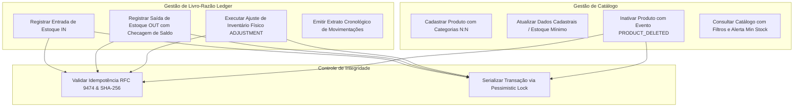

# Product Requirement Document (PRD)
## Sistema de Gestão de Estoque Físico e Livro-Razão (Ledger) Perpétuo

---

## 1. Visão Geral e Objetivo do Produto

### 1.1. Contexto do Negócio
A gestão tradicional de estoques em aplicações corporativas frequentemente adota abordagens destrutivas baseadas em operações `UPDATE` diretas sobre colunas de quantidade (`UPDATE products SET quantity = quantity - ?`). Essa modelagem simples acarreta falhas críticas:
- Perda irreversível do histórico contábil e auditoria retroativa.
- Vulnerabilidade crônica a condições de corrida (*race conditions*) em acessos concorrentes.
- Falta de integridade referencial quando registros de produtos são excluídos fisicamente.
- Incerteza operacional: incapacidade de auditar o saldo exato em uma data passada ou de apontar o responsável e a justificativa de uma divergência de inventário.

### 1.2. Objetivo Estratégico
O objetivo deste produto é fornecer uma plataforma corporativa de **gestão de estoque físico estritamente quantitativa**, pautada pelo princípio contábil de **Livro-Razão Perpétuo (Append-Only Ledger)**. Cada grama, mililitro ou unidade que entra, sai ou é corrigida no sistema é tratada como um lançamento imutável, garantindo rastreabilidade perene, auditabilidade matemática irrefutável e tolerância a falhas de rede por meio de idempotência mandatória garantida pelo backend.

---

## 2. Escopo e Limites do Sistema

### 2.1. Escopo Positivo (In-Scope)
- **Gestão de Catálogo Físico:** Cadastro, inativação lógica (*soft-delete*) e categorização flexível N:N de produtos físicos.
- **Livro-Razão Contábil (Append-Only Ledger):** Registro imutável de todas as movimentações físicas (`IN`, `OUT`, `ADJUSTMENT`, `PRODUCT_DELETED`).
- **Garantia de Não-Negatividade de Saldo:** Bloqueio sistêmico estrito para impedir saldos físicos negativos em operações de saída.
- **Ajustes de Inventário Contínuos:** Apuração de contagens físicas com cálculo automático de deltas e justificativa mandatória.
- **Precisão Contábil Absoluta:** Manipulação de frações via inteiros de escala fixa ($10^3$), eliminando arredondamentos imprecisos de ponto flutuante.
- **Idempotência no Backend (RFC 9474):** Deduplicação semântica automática, proteção contra *double-click* e tratamento determinístico de retransmissões de rede.
- **Alertas de Reposição:** Sinalização dinâmica de produtos com estoque igual ou inferior ao patamar mínimo configurado.

### 2.2. Não-Escopo Explícito (Out-of-Scope)
Para preservar o rigor, desempenho e simplicidade do domínio quantitativo físico, os seguintes aspectos **NÃO fazem parte do escopo deste sistema**:
1. **Sem Precificação e Valoração Monetária:** O sistema não registra preços unitários, valores de venda, custos de aquisição ou margens de lucro. O foco é **100% quantitativo/físico**.
2. **Sem Métodos Contábeis Financeiros:** Não há cálculo de Custo Médio Ponderado (CMP), FIFO/PEPS financeiro ou LIFO/UEPS monetário.
3. **Sem Módulos Financeiros ou Fiscais:** Não há emissão de Notas Fiscais Eletrônicas (NF-e, NFC-e), boletos, faturamento, contas a pagar ou contas a receber.
4. **Sem Gestão de Endereçamento Complexo (WMS Avançado):** O escopo inicial não contempla posições de rua/bloco/prateleira nem rotas de *picking/packing*.

---

## 3. Personas e Usuários do Sistema

| Persona | Perfil e Responsabilidades | Principais Dores & Necessidades |
| :--- | :--- | :--- |
| **Operador de Almoxarifado** *(Almoxarife)* | Responsável pelo recebimento físico, separação para consumo/expedição e contagem periódica nas prateleiras. | Precisa de interface rápida para registrar entradas e saídas sem medo de duplicar itens ao clicar duas vezes; precisa de segurança contra digitação de saldos negativos. |
| **Gestor de Suprimentos & Logística** | Responsável pelo planejamento de compras, monitoramento de ruptura de estoque e parametrização do catálogo. | Precisa de visão imediata de itens com estoque baixo (`min_stock`) e organização clara por múltiplas categorias temáticas. |
| **Auditor / Controlador de Qualidade** | Responsável pela integridade patrimonial, compliance operacional e auditoria de divergências de inventário. | Exige extrato histórico perpétuo: nenhum registro pode ser alterado ou deletado. Precisa entender exatamente quem alterou o estoque, quando, por qual motivo e com qual saldo resultante. |

---

## 4. Regras de Negócio Fundamentais (RN)

### RN-01: Categorização N:N (Muitos-para-Muitos)
- Um produto pode pertencer a **zero, uma ou múltiplas categorias** simultaneamente (ex: o produto "Álcool Isopropílico" pode pertencer às categorias *Solventes*, *Inflamáveis* e *Material de Limpeza*).
- Uma categoria agrupa múltiplos produtos e possui atributos descritivos próprios (nome, descrição e cor identificadora para interface).
- A remoção de uma categoria não exclui os produtos associados, desfazendo apenas o vínculo associativo na tabela relacional intermediária.

### RN-02: Unidades de Medida Padronizadas (UOM)
- Cada produto possui obrigatoriamente uma Unidade de Medida (UOM) registrada em formato padronizado de letras maiúsculas (ex: `UN`, `KG`, `L`, `M`, `CX`, `G`).
- A unidade de medida dita a interpretação semântica do valor fracionário para exibição e conferência operacional.

### RN-03: Quantidades Fracionárias com Escala Inteira ($10^3$)
- **Proibição de Ponto Flutuante:** É terminantemente proibido o uso de tipos de ponto flutuante (`float`, `double`, `real`) na camada de banco de dados e nos cálculos contábeis de domínio, evitando os erros de representação binária da norma IEEE 754.
- **Convenção de Escala Fixa Contábil:** Toda quantidade fracionária é multiplicada pelo fator de escala $K = 1.000$ e persistida no banco como um número inteiro de 64 bits (`BIGINT`):
  $$\text{Valor Persistido} = \text{round}(\text{Quantidade Real} \times 1.000)$$
- **Regra de Conversão nos Schemas e APIs:**
  - A API externa aceita números decimais na entrada JSON (ex: `2.5` ou `"2.500"`).
  - O DTO/Validator converte imediatamente para `2500` antes de invocar os Use Cases de domínio.
  - As respostas da API fornecem tanto o valor inteiro escalado (`2500`) quanto o valor real fracionário (`2.500`) e a string formatada para exibição (`"2,500 KG"`).

| Exemplo Físico | Quantidade Real | Armazenado no Banco (`BIGINT`) | Exibição Formatada |
| :--- | :--- | :--- | :--- |
| Parafuso de Aço | `1` unidade | `1000` | `1 UN` |
| Resina Epóxi | `2,500` quilogramas | `2500` | `2,500 KG` |
| Reagente Químico | `0,125` litros | `125` | `0,125 L` |
| Fio de Cobre | `15,750` metros | `15750` | `15,750 M` |

### RN-04: Alerta de Estoque Mínimo (`min_stock`)
- Cada produto pode opcionalmente definir uma quantidade de estoque mínimo de segurança (`min_stock`), também armazenada em escala fixa $10^3$.
- O sistema computa dinamicamente a propriedade booleana `is_low_stock`:
  $$\text{is\_low\_stock} = \begin{cases} \text{TRUE}, & \text{se } \text{min\_stock} \neq \text{null} \land \text{current\_quantity} \le \text{min\_stock} \\ \text{FALSE}, & \text{caso contrário} \end{cases}$$
- Itens em condição de estoque baixo devem ser destacados prioritariamente nas listagens e relatórios operacionais.

### RN-05: Padrão Ledger (Livro-Razão Append-Only)
- **Imutabilidade Absoluta:** A tabela de movimentações de estoque (`stock_movements`) é um registro contábil de escrita estritamente cumulativa (*Append-Only*).
  - Operações de `UPDATE` sobre linhas de movimentação são expressamente proibidas.
  - Operações de `DELETE` (Hard-Delete) sobre linhas de movimentação são expressamente proibidas.
- **Tipos de Lançamento no Ledger:**
  1. **`IN` (Entrada Física):**
     - Incrementa a quantidade física disponível (ex: recebimento de insumos, devolução).
     - Delta físico: positivo ($+q$).
     - Novo saldo: $\text{balance\_after} = \text{current\_balance} + q$.
  2. **`OUT` (Saída Física):**
     - Decrementa a quantidade física disponível (ex: consumo na produção, descarte por avaria).
     - Delta físico: negativo ($-q$).
     - Validação estrita: se $\text{current\_balance} < q$, a operação é **rejeitada com erro de negócio 422**, impedindo saldo negativo.
     - Novo saldo: $\text{balance\_after} = \text{current\_balance} - q \ge 0$.
  3. **`ADJUSTMENT` (Ajuste de Inventário Físico):**
     - Utilizado exclusivamente para conciliação física após contagem periódica.
     - O operador informa a **nova quantidade contada** ($Q_{\text{contada}}$) e o **motivo obrigatório** (ex: "Inventário físico semestral").
     - O sistema calcula o delta real: $\Delta = Q_{\text{contada}} - Q_{\text{atual}}$.
     - Grava no Ledger a movimentação com o delta apurado e $\text{balance\_after} = Q_{\text{contada}}$.
  4. **`PRODUCT_DELETED` (Evento Contábil de Inativação de Produto):**
     - Detalhado na RN-06.

### RN-06: Ciclo de Exclusão de Produto (Soft-Delete com Rastreabilidade Perpétua)
- Um produto que possui movimentações contábeis jamais pode ser fisicamente expurgado da base de dados (`NO HARD DELETE` na tabela `products`).
- Ao acionar a exclusão de um produto:
  1. A entidade `Product` é marcada como inativa: `is_active = FALSE`, `deleted_at = NOW()`.
  2. O produto é ocultado das listagens normais do catálogo e fica impedido de receber novas movimentações de `IN`, `OUT` ou `ADJUSTMENT`.
  3. É gerado obrigatoriamente um registro no Ledger com:
     - `type = "PRODUCT_DELETED"`
     - `quantity = 0`
     - `balance_after = current_balance` (preserva o saldo remanescente no momento da descontinuação)
     - `reason = "[Motivo fornecido pelo operador]"`
  4. A integridade referencial contábil permanece 100% íntegra: relatórios históricos de meses ou anos anteriores continuam refletindo a existência e movimentações daquele item.

### RN-07: Idempotência Mandatória no Backend (RFC 9474)
- **Autoridade Central:** O backend não confia no estado do cliente para garantir não-duplicação. Ele é a única fonte da verdade e o árbitro das requisições mutatórias (`POST`, `PUT`, `DELETE`).
- **Chave de Idempotência (`X-Idempotency-Key`):**
  - O cliente deve enviar o cabeçalho HTTP `X-Idempotency-Key` (UUIDv4 gerado pelo cliente).
  - O backend calcula o **hash semântico SHA-256** da requisição:
    $$\text{hash} = \text{SHA256}(\text{método} + \text{path} + \text{canonical\_json\_payload})$$
- **Cenários de Processamento:**
  1. **Primeira Requisição:** Registro persistido com status `PROCESSING`. A operação é executada dentro de uma transação com bloqueio pessimista. Ao término bem-sucedido, o registro é atualizado para `COMPLETED` com o código de resposta (ex: `201 Created`) e o corpo retornado.
  2. **Retransmissão Legítima (Mesma Chave + Mesmo Hash):** Se a requisição chega com a mesma chave e o mesmo hash semântico após a conclusão da original, o backend retorna imediatamente o payload em cache com código `200/201` e o cabeçalho `X-Cache: HIT`. Nenhuma movimentação duplicada é gerada.
  3. **Conflito de Idempotência (Mesma Chave + Hash Diferente):** Se uma chave já utilizada for enviada com parâmetros ou corpo divergente, o backend rejeita a solicitação com `HTTP 409 Conflict`, explicitando que a chave já foi consumida para outra operação.
  4. **Requisição Concorrente em Andamento (Mesma Chave durante `PROCESSING`):** O backend responde com `HTTP 409 Conflict` ou `HTTP 425 Too Early`, orientando o cliente a aguardar o processamento da requisição em trânsito.
  5. **Requisição Sem Chave de Idempotência:** Para mitigar duplo clique acidental, o backend mantém um mecanismo de deduplicação semântica baseado em janela temporal (10 segundos) sobre a tupla `(produto_id, tipo, quantidade, motivo)`.

---

## 5. Casos de Uso do Sistema (Use Cases)

### UC-01: Cadastrar Produto
- **Ator:** Almoxarife / Gestor.
- **Entrada:** Nome, descrição, unidade de medida (UOM), estoque mínimo (opcional), lista de IDs de categorias existentes.
- **Regras:** Nome único ou validado; quantidades em escala x1000; saldo inicial nasce em zero (`current_quantity = 0`).

### UC-02: Registrar Entrada de Estoque (`IN`)
- **Ator:** Almoxarife.
- **Entrada:** ID do produto, quantidade física a acrescentar ($q > 0$), motivo/documento de entrada, `X-Idempotency-Key`.
- **Fluxo:**
  1. Validação de idempotência da requisição.
  2. Obtenção de lock pessimista (`FOR UPDATE`) sobre a linha do produto no banco de dados.
  3. Cálculo do novo saldo: $\text{balance\_after} = \text{current\_quantity} + q$.
  4. Atualização de `Product.current_quantity = balance_after`.
  5. Inserção append-only no `stock_movements`.
  6. Finalização e commit da transação atômica.
  7. Retorno dos dados atualizados com `HTTP 201 Created`.

### UC-03: Registrar Saída de Estoque (`OUT`)
- **Ator:** Almoxarife.
- **Entrada:** ID do produto, quantidade física a retirar ($q > 0$), motivo/requisição, `X-Idempotency-Key`.
- **Fluxo:**
  1. Validação de idempotência da requisição.
  2. Obtenção de lock pessimista (`FOR UPDATE`) sobre a linha do produto no banco de dados.
  3. Validação de saldo: se $\text{current\_quantity} < q$, aborta transação e lança `InsufficientStockError` (`HTTP 422 Unprocessable Entity`).
  4. Cálculo do novo saldo: $\text{balance\_after} = \text{current\_quantity} - q$.
  5. Atualização de `Product.current_quantity = balance_after`.
  6. Inserção append-only no `stock_movements`.
  7. Commit da transação e retorno com `HTTP 201 Created`.

### UC-04: Registrar Ajuste de Inventário Físico (`ADJUSTMENT`)
- **Ator:** Auditor / Almoxarife.
- **Entrada:** ID do produto, nova quantidade física contada ($Q_{\text{contada}} \ge 0$), motivo explicativo mandatório, `X-Idempotency-Key`.
- **Fluxo:**
  1. Validação de idempotência e conferência do motivo (não pode ser nulo ou vazio).
  2. Obtenção de lock pessimista (`FOR UPDATE`) sobre a linha do produto.
  3. Obtenção do saldo atual no banco: $Q_{\text{atual}}$.
  4. Se $Q_{\text{contada}} == Q_{\text{atual}}$, retorna sucesso sem gerar movimentação redundante (ou gera ajuste nulo se auditoria exigir).
  5. Se $Q_{\text{contada}} \ne Q_{\text{atual}}$, calcula $\Delta = Q_{\text{contada}} - Q_{\text{atual}}$.
  6. Atualização de `Product.current_quantity = Q_{\text{contada}}`.
  7. Inserção append-only no `stock_movements` com `quantity = Delta`, `balance_after = Q_contada`.
  8. Commit e retorno com `HTTP 201 Created`.

### UC-05: Inativação de Produto com Evento Contábil (`PRODUCT_DELETED`)
- **Ator:** Gestor.
- **Entrada:** ID do produto, motivo do descarte / descontinuação, `X-Idempotency-Key`.
- **Fluxo:**
  1. Validação de idempotência.
  2. Lock pessimista sobre o produto.
  3. Verificação de existência e se o produto já não está desativado (`is_active == False`).
  4. Atualização lógica: `Product.is_active = False`, `Product.deleted_at = NOW()`.
  5. Inserção no Ledger de evento contábil: `type = "PRODUCT_DELETED"`, `quantity = 0`, `balance_after = Product.current_quantity`, `reason = motivo`.
  6. Commit da transação. Nenhuma linha de histórico anterior é deletada.

### UC-06: Consultar Extrato do Ledger (Auditoria)
- **Ator:** Auditor / Gestor / Almoxarife.
- **Filtros Disponíveis:** ID do produto, período (data inicial e data final), tipo de movimentação (`IN`, `OUT`, `ADJUSTMENT`, `PRODUCT_DELETED`), paginação (`limit`, `offset`).
- **Saída:** Lista cronológica de movimentos com ID, timestamp UTC, delta em escala e decimal, saldo resultante em escala e decimal, motivo e chave de idempotência.

---

## 6. Requisitos Não-Funcionais (RNF)

| Identificador | Categoria | Requisito Técnico |
| :--- | :--- | :--- |
| **RNF-01** | Consistência de Dados | Conformidade ACID total. Isolamento transacional assegurado por meio de PostgreSQL 16 com bloqueio pessimista de linha (`SELECT ... FOR UPDATE`). |
| **RNF-02** | Imutabilidade do Ledger | A camada de persistência de dados não deve disponibilizar métodos de `update` ou `delete` para a entidade `StockMovement`. |
| **RNF-03** | Precisão Aritmética | Ausência total de tipos `FLOAT` em banco e domínio. Escala inteira fixa de 3 casas ($10^3$) armazenada em `BIGINT`. |
| **RNF-04** | Idempotência e Rede | Conformidade com as diretrizes da **RFC 9474**. Registro em banco das requisições com cache persistente da resposta para tolerância a desconexões e duplo clique. |
| **RNF-05** | Tempo de Resposta | P95 inferior a 150ms para registro de movimentações de estoque sob carga nominal. |
| **RNF-06** | Versionamento de Esquema | Todo o ciclo de vida do banco de dados deve ser gerenciado exclusivamente através de migrações versionadas com **Alembic**, banindo `create_all()` em produção. |
| **RNF-07** | Arquitetura | Clean Architecture Modular com separação estrita entre Domínio, Aplicação, Infraestrutura e Interfaces de entrada. |

---

## 7. Critérios de Aceitação e Validação do PRD

1. **Rastreabilidade Matemática:**
   - Para qualquer produto, a soma cumulativa dos deltas de todas as suas movimentações no Ledger deve ser rigorosamente igual ao seu `Product.current_quantity`.
   $$\sum_{i=1}^{n} \text{movement}_i\text{.quantity} = \text{Product.current\_quantity}$$
2. **Proteção de Saldo Negativo:**
   - Qualquer tentativa concorrente ou isolada de registrar saída (`OUT`) superior ao saldo disponível deve ser sumariamente bloqueada com erro descritivo e status HTTP 422.
3. **Resistência a Duplo Clique:**
   - Duas requisições simultâneas ou sequenciais enviadas com o mesmo cabeçalho `X-Idempotency-Key` e mesmo payload devem resultar em exatamente **uma única inserção no Ledger** e duas respostas bem-sucedidas idênticas (a segunda contendo `X-Cache: HIT`).
4. **Preservação de Histórico no Soft-Delete:**
   - Ao inativar um produto, todo o seu extrato anterior no Ledger permanece integralmente consultável, com acréscimo da linha de evento `PRODUCT_DELETED`. Nenhuma foreign key é quebrada.
