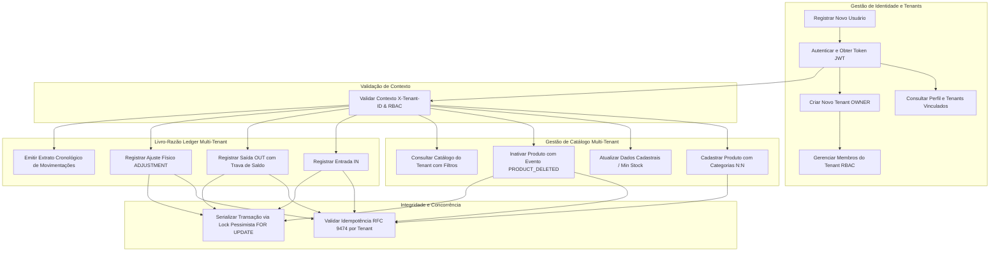

# Product Requirement Document (PRD)
## Sistema de Gestão de Estoque Físico, Livro-Razão (Ledger) Perpétuo e Multi-Tenancy B2B

---

## 1. Visão Geral e Objetivo do Produto

### 1.1. Contexto do Negócio
A gestão tradicional de estoques em aplicações corporativas frequentemente adota abordagens destrutivas baseadas em operações `UPDATE` diretas sobre colunas de quantidade (`UPDATE products SET quantity = quantity - ?`). Essa modelagem simples acarreta falhas críticas:
- Perda irreversível do histórico contábil e impossibilidade de auditoria retroativa.
- Vulnerabilidade crônica a condições de corrida (*race conditions*) em acessos concorrentes simultâneos.
- Falta de integridade referencial quando registros de produtos são excluídos fisicamente.
- Incerteza operacional: incapacidade de auditar o saldo exato em uma data passada ou de apontar o responsável e a justificativa de uma divergência de inventário.
- Ausência de segregação multi-organizacional: sistemas legados monocontratuais impedem que múltiplos almoxarifados ou empresas operem de forma independente e isolada sob a mesma infraestrutura de software.

### 1.2. Objetivo Estratégico
O objetivo deste produto é fornecer uma plataforma corporativa **SaaS B2B de gestão de estoque físico estritamente quantitativa e multi-tenant**, pautada pelo princípio contábil de **Livro-Razão Perpétuo (Append-Only Ledger)**. 

Cada grama, mililitro ou unidade física que entra, sai ou é corrigida no sistema é tratada como um lançamento imutável vinculado rigorosamente a um **Tenant** (empresa/almoxarifado), garantindo:
1. **Isolamento Lógico Absoluto:** Segregação estrita de dados em nível de banco de dados entre organizações distintas.
2. **Identidade Global e Papéis Flexíveis:** Usuários únicos autenticados via JWT que podem participar de múltiplos tenants exercendo funções diferenciadas (`OWNER`, `GESTOR`, `ALMOXARIFE`, `AUDITOR`).
3. **Auditabilidade Matemática Irrefutável:** Histórico perpétuo e cálculo de deltas exatos com precisão contábil em inteiros escalados ($10^3$).
4. **Resiliência e Idempotência:** Tolerância a falhas de rede e prevenção de duplo clique via conformidade com a RFC 9474 gerenciada pelo backend.

---

## 2. Escopo e Limites do Sistema

### 2.1. Escopo Positivo (In-Scope)
- **Multi-Tenancy e Isolamento Estrito:** Organização lógica em múltiplos tenants (almoxarifados ou organizações corporativas independentes). Toda entidade de catálogo, movimentação e idempotência possui obrigatoriamente um `tenant_id` nativo.
- **Autenticação Segura e Gestão de Identidade:** Cadastro centralizado de usuários com senhas criptografadas (`bcrypt`/`argon2`) e autenticação stateless baseada em OAuth2 Password Bearer com tokens JWT.
- **Associação N:N Usuário-Tenant com RBAC:** Um usuário pode pertencer a múltiplos tenants com papéis granulares (`OWNER`, `GESTOR`, `ALMOXARIFE`, `AUDITOR`).
- **Criação Autônoma de Tenants:** Usuários autenticados podem criar novos tenants, assumindo automaticamente a titularidade (`OWNER`).
- **Contexto de Execução por Requisição:** Roteamento e autorização baseados no cabeçalho `X-Tenant-ID`, validado contra as associações do usuário logado.
- **Gestão de Catálogo Físico Isolado:** Cadastro, inativação lógica (*soft-delete*) e categorização flexível N:N de produtos físicos segregados por tenant.
- **Livro-Razão Contábil (Append-Only Ledger):** Registro imutável de todas as movimentações físicas (`IN`, `OUT`, `ADJUSTMENT`, `PRODUCT_DELETED`) segregadas por tenant.
- **Garantia de Não-Negatividade de Saldo:** Bloqueio sistêmico estrito para impedir saldos físicos negativos em operações de saída.
- **Ajustes de Inventário Contínuos:** Apuração de contagens físicas com cálculo automático de deltas e justificativa mandatória.
- **Precisão Contábil Absoluta:** Manipulação de frações via inteiros de escala fixa ($10^3$), eliminando arredondamentos imprecisos de ponto flutuante.
- **Idempotência no Backend (RFC 9474):** Deduplicação semântica automática, proteção contra *double-click* e isolamento de chaves por tenant.
- **Alertas de Reposição:** Sinalização dinâmica de produtos com estoque igual ou inferior ao patamar mínimo configurado (`min_stock`).

### 2.2. Não-Escopo Explícito (Out-of-Scope)
Para preservar o rigor, desempenho e simplicidade do domínio quantitativo físico, os seguintes aspectos **NÃO fazem parte do escopo deste sistema**:
1. **Sem Precificação e Valoração Monetária:** O sistema não registra preços unitários, valores de venda, custos de aquisição ou margens de lucro. O foco é **100% quantitativo/físico**.
2. **Sem Métodos Contábeis Financeiros:** Não há cálculo de Custo Médio Ponderado (CMP), FIFO/PEPS financeiro ou LIFO/UEPS monetário.
3. **Sem Módulos Financeiros ou Fiscais:** Não há emissão de Notas Fiscais Eletrônicas (NF-e, NFC-e), boletos, faturamento, contas a pagar ou contas a receber.
4. **Sem Gestão de Endereçamento Complexo (WMS Avançado):** O escopo não contempla posições de rua/bloco/prateleira nem rotas de *picking/packing*.

---

## 3. Personas, Papéis no Tenant (RBAC) e Usuários

O sistema separa a **Identidade Global do Usuário** do seu **Papel Contextual no Tenant**. Um mesmo usuário pode atuar como `OWNER` em um almoxarifado de sua propriedade e como `AUDITOR` em outro almoxarifado corporativo.

| Persona / Papel no Tenant | Responsabilidades e Atribuições | Principais Dores & Necessidades |
| :--- | :--- | :--- |
| **Proprietário da Organização** *(OWNER)* | Responsável máximo pelo Tenant. Cria o almoxarifado, gerencia parametrizações corporativas, convida e remove membros, delega papéis e possui acesso operacional e auditor irrestrito. | Precisa de autonomia para criar e configurar almoxarifados sem intervenção técnica externa; necessita de controle total sobre quem acessa os dados da sua empresa. |
| **Gestor de Suprimentos & Logística** *(GESTOR)* | Responsável pelo planejamento operacional, monitoramento de estoques mínimos (`min_stock`), parametrização de categorias e produtos, e admissão de operadores e auditores. | Precisa de visão holística do catálogo, filtros rápidos por estoque baixo e governança sobre produtos sem risco de perda de rastreabilidade contábil. |
| **Operador de Almoxarifado** *(ALMOXARIFE)* | Responsável pelo recebimento físico, separação para consumo/expedição e contagem periódica nas prateleiras. | Precisa de interface rápida para registrar entradas e saídas sem medo de duplicar itens ao clicar duas vezes; precisa de bloqueio contra saldos negativos. Não deve ter permissão para alterar cadastros ou excluir itens. |
| **Auditor / Controlador de Qualidade** *(AUDITOR)* | Responsável pela integridade patrimonial, compliance contábil e auditoria de divergências físicas de inventário. | Exige extrato histórico perpétuo: nenhum registro pode ser alterado ou deletado. Tem autoridade para executar contagens físicas (`ADJUSTMENT`) com justificativa obrigatória, mas sem permissão para movimentações de rotina (`IN`/`OUT`). |

---

## 4. Regras de Negócio Fundamentais (RN)

### RN-01: Arquitetura Multi-Tenant e Isolamento Estrito de Dados
- **Tenant como Fronteira de Isolamento:** Um *Tenant* representa uma organização jurídica, empresa ou almoxarifado autônomo.
- **Obrigatoriedade de `tenant_id`:** Todas as entidades de negócio essenciais — produtos (`products`), categorias (`categories`), movimentações contábeis (`stock_movements`) e registros de idempotência (`idempotency_records`) — contêm uma coluna `tenant_id` (tipo `UUID` nativo com restrição `NOT NULL` e chave estrangeira referenciando `tenants.id`).
- **Barreira Lógica contra Vazamento de Dados (*Zero Data Leakage*):** Nenhuma operação de leitura, escrita, atualização ou agregação pode cruzar fronteiras de tenants. Uma consulta executada no Tenant A jamais retorna ou altera dados pertencentes ao Tenant B.
- **Unicidade Escopada por Tenant:** Nomes de categorias e produtos são únicos ou indexados dentro do escopo do respectivo tenant. Duas empresas diferentes podem cadastrar a categoria "Solventes" ou o produto "Parafuso M6" independentemente.

### RN-02: Relação N:N Usuário-Tenant e Papéis (RBAC)
- Um usuário possui uma conta global única identificada pelo seu email.
- O vínculo entre usuários e tenants é modelado como relação N:N através da tabela associativa `tenant_memberships`.
- Cada vínculo possui obrigatoriamente um papel (*role*): `OWNER`, `GESTOR`, `ALMOXARIFE` ou `AUDITOR`.
- Apenas membros ativos do tenant podem acessar seus recursos.

### RN-03: Criação Autônoma de Tenant e Atribuição de Propriedade
- Apenas usuários devidamente autenticados podem submeter a criação de um novo tenant (`POST /api/tenants`).
- No ato da criação, o sistema executa uma transação atômica que:
  1. Persiste o novo registro na tabela `tenants`.
  2. Insere um registro na tabela `tenant_memberships` associando o usuário criador como `role = 'OWNER'`.
- O criador torna-se o administrador nato daquele tenant, podendo convidar outros usuários.

### RN-04: Autenticação Segura JWT e Contexto de Execução (`X-Tenant-ID`)
- **Autenticação:** Baseada no padrão OAuth2 Password Bearer com tokens JSON Web Token (JWT - RFC 7519) assinados via algoritmo criptográfico `HS256`.
- **Armazenamento de Senhas:** Senhas são salgadas e criptografadas utilizando `passlib[bcrypt]` com fator de trabalho mínimo de 12 (ou `argon2`).
- **Contexto de Tenant:** Requisições a endpoints protegidos de domínio exigem a presença do cabeçalho HTTP:
  `X-Tenant-ID: <UUID>`
- **Validação de Acesso:** O backend intercepta o cabeçalho e valida:
  1. Se o tenant existe e está ativo.
  2. Se o usuário logado possui associação ativa com o tenant solicitado.
  3. Se o papel do usuário no tenant confere permissão para a ação solicitada (RBAC).
  - Em caso de violação de pertinência de tenant, responde `HTTP 403 Forbidden` com payload RFC 7807 (`tenant-access-denied`).

### RN-05: Categorização N:N no Âmbito do Tenant
- Um produto pode pertencer a zero, uma ou múltiplas categorias simultaneamente no escopo do seu tenant.
- A categoria pertence exclusivamente ao tenant especificado (`tenant_id`).
- A remoção de uma categoria desfaz o vínculo associativo na tabela intermediária sem deletar os produtos vinculados.

### RN-06: Unidades de Medida Padronizadas (UOM)
- Cada produto possui obrigatoriamente uma Unidade de Medida (UOM) registrada em maiúsculas (ex: `UN`, `KG`, `L`, `M`, `CX`, `G`).

### RN-07: Quantidades Fracionárias com Escala Inteira ($10^3$)
- **Proibição de Ponto Flutuante:** É terminantemente proibido o uso de tipos de ponto flutuante (`float`, `double`, `real`) no banco de dados e nos cálculos contábeis de domínio.
- **Convenção de Escala Fixa Contábil:** Toda quantidade fracionária é multiplicada pelo fator $K = 1.000$ e armazenada como `BIGINT`:
  $$\text{Valor Persistido} = \text{round}(\text{Quantidade Real} \times 1.000)$$
- Os endpoints aceitam valores decimais na entrada e retornam valores escalados, valores reais e representações formatadas (ex: `"2,500 KG"`).

### RN-08: Alerta de Estoque Mínimo (`min_stock`)
- Cada produto pode definir uma quantidade mínima de segurança (`min_stock` em escala $10^3$).
- O sistema computa dinamicamente a propriedade booleana `is_low_stock` no contexto do tenant:
  $$\text{is\_low\_stock} = (\text{min\_stock} \neq \text{null}) \land (\text{current\_quantity} \le \text{min\_stock})$$

### RN-09: Padrão Ledger (Livro-Razão Append-Only Isolado por Tenant)
- **Imutabilidade Absoluta:** A tabela `stock_movements` é estritamente de escrita cumulativa (*Append-Only*). Operações de `UPDATE` e `DELETE` são terminantemente banidas.
- **Vinculação Dupla:** Cada lançamento no Ledger referencia tanto o `product_id` quanto o `tenant_id` com constraints `ON DELETE RESTRICT`.
- **Tipos de Lançamento:**
  1. **`IN` (Entrada Física):** Incrementa a quantidade física disponível ($\text{balance\_after} = \text{current} + q$).
  2. **`OUT` (Saída Física):** Decrementa a quantidade física. Se $\text{current} < q$, aborta imediatamente com erro `HTTP 422 Unprocessable Entity`, impedindo saldo negativo.
  3. **`ADJUSTMENT` (Ajuste Físico de Inventário):** Utilizado para conciliação contábil com justificativa obrigatória, apurando o delta $\Delta = Q_{\text{contada}} - Q_{\text{atual}}$.
  4. **`PRODUCT_DELETED` (Inativação Contábil):** Registrado ao desativar logicamente um produto, preservando o saldo e o motivo.

### RN-10: Ciclo de Exclusão de Produto (Soft-Delete com Rastreabilidade Perpétua)
- Um produto que possui movimentações contábeis jamais sofre exclusão física (`NO HARD DELETE`).
- Ao inativar: `is_active = FALSE`, `deleted_at = NOW()`, e emite evento `PRODUCT_DELETED` no Ledger. O histórico permanece 100% auditável.

### RN-11: Idempotência Mandatória por Tenant (RFC 9474)
- O cliente envia o cabeçalho `X-Idempotency-Key` (UUIDv4).
- O backend calcula o hash semântico SHA-256 do payload normalizado.
- O registro de idempotência é associado ao `tenant_id`. Chaves idênticas em tenants diferentes operam em namespaces isolados sem colisões.
- Replays legítimos (mesma chave e mesmo hash) retornam resposta em cache (`X-Cache: HIT`).
- Chaves reutilizadas com payloads diferentes geram `HTTP 409 Conflict`.

---

## 5. Casos de Uso do Sistema (Use Cases)

### UC-AUTH-01: Cadastro de Usuário (`Register`)
- **Ator:** Usuário não autenticado.
- **Entrada:** `email`, `password`, `full_name`.
- **Regras:** Validação de email único no sistema, validação de complexidade de senha ($\ge 8$ caracteres), criptografia via `bcrypt`. Retorna `201 Created`.

### UC-AUTH-02: Login e Emissão de Token JWT (`Login`)
- **Ator:** Usuário cadastrado.
- **Entrada:** `email` e `password`.
- **Regras:** Verificação criptográfica de senha. Geração de JWT assinado com claims `sub`, `email`, `exp` e `type=access`. Retorna `200 OK` com `access_token`.

### UC-AUTH-03: Perfil do Usuário e Relação de Tenants (`Me`)
- **Ator:** Usuário autenticado.
- **Saída:** Dados cadastrais do usuário e lista de todos os tenants em que possui participação ativa com o papel correspondente (`role`).

### UC-TEN-01: Criar Novo Almoxarifado / Tenant
- **Ator:** Qualquer usuário autenticado.
- **Entrada:** `name`, `slug` (opcional), `description`.
- **Regras:** Transação atômica cria o registro em `tenants` e associa o usuário criador em `tenant_memberships` com papel `OWNER`.

### UC-TEN-02: Gerenciar Membros do Tenant
- **Ator:** `OWNER` ou `GESTOR` do tenant.
- **Ações:** Convidar novo membro por email atribuindo uma role (`ALMOXARIFE`, `AUDITOR`, `GESTOR`); alterar papéis; remover membros (respeitando a regra de retenção do último `OWNER`).

### UC-01: Cadastrar Produto no Tenant
- **Ator:** `OWNER` ou `GESTOR` do tenant.
- **Entrada:** `X-Tenant-ID`, nome, descrição, UOM, estoque mínimo, categorias do tenant.
- **Regras:** Produto persistido com `tenant_id` obrigatório e `current_quantity = 0`. Categorias devem pertencer obrigatoriamente ao mesmo tenant.

### UC-02: Registrar Entrada de Estoque (`IN`)
- **Ator:** `OWNER`, `GESTOR` ou `ALMOXARIFE` do tenant.
- **Entrada:** `X-Tenant-ID`, `product_id`, quantidade física ($q > 0$), motivo, `X-Idempotency-Key`.
- **Fluxo:**
  1. Validação de token JWT, `X-Tenant-ID` e permissão RBAC.
  2. Validação de idempotência no namespace do tenant.
  3. Lock pessimista (`FOR UPDATE`) sobre a linha do produto no tenant (`WHERE id = :id AND tenant_id = :tenant_id`).
  4. Atualização de saldo e inserção append-only no `stock_movements` contendo `tenant_id`.
  5. Commit atômico.

### UC-03: Registrar Saída de Estoque (`OUT`)
- **Ator:** `OWNER`, `GESTOR` ou `ALMOXARIFE` do tenant.
- **Entrada:** `X-Tenant-ID`, `product_id`, quantidade física ($q > 0$), motivo, `X-Idempotency-Key`.
- **Fluxo:**
  1. Lock pessimista sobre o produto no escopo do tenant.
  2. Se $\text{current\_quantity} < q$, aborta transação e lança `InsufficientStockError` (`HTTP 422`).
  3. Atualiza saldo físico e grava lançamento de saída negativa no Ledger com `tenant_id`.
  4. Retorna confirmação `HTTP 201 Created`.

### UC-04: Registrar Ajuste de Inventário Físico (`ADJUSTMENT`)
- **Ator:** `OWNER`, `GESTOR`, `ALMOXARIFE` ou `AUDITOR` do tenant.
- **Entrada:** `X-Tenant-ID`, `product_id`, quantidade contada ($Q_{\text{contada}} \ge 0$), motivo obrigatório, `X-Idempotency-Key`.
- **Fluxo:**
  1. Apura $\Delta = Q_{\text{contada}} - Q_{\text{atual}}$.
  2. Atualiza saldo para $Q_{\text{contada}}$ e insere movimentação com o delta apurado no Ledger do tenant.

### UC-05: Inativação de Produto (`PRODUCT_DELETED`)
- **Ator:** `OWNER` ou `GESTOR` do tenant.
- **Entrada:** `X-Tenant-ID`, `product_id`, motivo, `X-Idempotency-Key`.
- **Regras:** Marca `is_active = False` no produto do tenant e grava evento `PRODUCT_DELETED` no Ledger.

### UC-06: Consultar Extrato do Ledger do Tenant
- **Ator:** Qualquer membro ativo do tenant (`OWNER`, `GESTOR`, `ALMOXARIFE`, `AUDITOR`).
- **Filtros:** `X-Tenant-ID`, período de datas, produto, tipo de movimentação, paginação.
- **Saída:** Lista cronológica de movimentos do respectivo tenant.

---

## 6. Requisitos Não-Funcionais (RNF)

| Identificador | Categoria | Requisito Técnico |
| :--- | :--- | :--- |
| **RNF-01** | Isolamento Multi-Tenant | Segregação estrita de dados em nível de aplicação e banco de dados via `tenant_id` obrigatório em todas as entidades e consultas. Risco zero de vazamento cruzado. |
| **RNF-02** | Segurança de Senhas | Criptografia irreversível com salt via `passlib[bcrypt]` (fator de custo mínimo de 12) ou `argon2`. Proibição absoluta de senhas em texto puro. |
| **RNF-03** | Autenticação Stateless | Tokens JWT (RFC 7519) assinados com `HS256`, tempo de expiração configurável e extração automática via `OAuth2PasswordBearer`. |
| **RNF-04** | Controle de Acesso (RBAC) | Verificação granular de papéis (`OWNER`, `GESTOR`, `ALMOXARIFE`, `AUDITOR`) por endpoint com bloqueio `HTTP 403 Forbidden` sob padrão RFC 7807. |
| **RNF-05** | Consistência ACID e Concorrência | Conformidade ACID garantida por PostgreSQL 16 com bloqueio pessimista de linha (`SELECT ... FOR UPDATE`) escopado pelo tenant. |
| **RNF-06** | Imutabilidade do Ledger | A camada de persistência proíbe expressamente métodos de `update` ou `delete` sobre `StockMovement`. |
| **RNF-07** | Precisão Aritmética | Ausência total de tipos `FLOAT` em banco e domínio. Escala inteira fixa de 3 casas ($10^3$) armazenada em `BIGINT`. |
| **RNF-08** | Idempotência e Rede | Conformidade com **RFC 9474** com cache persistente da resposta e escopo individualizado por tenant. |
| **RNF-09** | Versionamento de Esquema | Evolução de banco gerenciada 100% via migrações versionadas com **Alembic**, banindo `Base.metadata.create_all()` em produção. |
| **RNF-10** | Cobertura de Testes Mandatória | Cobertura de código mínima de **80%** aferida via `pytest-cov` com flag `--cov-fail-under=80`. |

---

## 7. Critérios de Aceitação e Validação do PRD

1. **Garantia de Isolamento Multi-Tenant:**
   - Requisições com `X-Tenant-ID` de um tenant não podem retornar, alterar ou interferir em dados de outro tenant sob nenhuma hipótese.
   - Tentativa de acesso a um tenant do qual o usuário não é membro resulta obrigatoriamente em `HTTP 403 Forbidden` (`tenant-access-denied`).
2. **Criação de Tenant e Vínculo Automático de OWNER:**
   - A criação de um tenant por um usuário autenticado registra atomicamente a organização e insere o usuário criador como `OWNER` da mesma.
3. **Imutabilidade e Rastreabilidade do Ledger:**
   - Para qualquer produto de qualquer tenant, a somatória dos deltas de suas movimentações é matematicamente idêntica a `Product.current_quantity`.
4. **Proteção Contra Saldo Negativo Concorrente:**
   - Operações simultâneas de saída são serializadas pelo banco e bloqueadas com `HTTP 422` se o saldo do tenant for insuficiente.
5. **Idempotência sem Colisão entre Tenants:**
   - Dois tenants distintos podem submeter requisições mutatórias com a mesma chave `X-Idempotency-Key` sem sofrer colisão ou conflito.
6. **Autenticação e Segurança de Tokens:**
   - Tokens expirados, assinaturas adulteradas ou credenciais incorretas são rejeitados com `HTTP 401 Unauthorized`.
