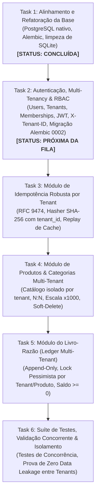

# Plano Detalhado de Implementação do Backend (TASKS)
## Decomposição de Tarefas Técnicas, Sequenciamento, Multi-Tenancy e Critérios de Aceitação

---

## 1. Visão Geral e Estratégia de Execução

Este documento decompõe o desenvolvimento do Backend em fases e tarefas atômicas sequenciais. Cada tarefa possui escopo estrito de arquivos a serem criados ou alterados, pré-condições bem definidas e procedimentos claros de validação e testes.

> [!IMPORTANT]
> **Regras de Execução Inegociáveis:**
> 1. Nenhuma tarefa deve ser iniciada sem que sua predecessora esteja formalmente concluída, com testes verdes e pull request mesclado na branch `dev`.
> 2. O código de produção conecta-se unicamente ao **PostgreSQL 16 via Docker**, sem qualquer uso de SQLite.
> 3. **Cobertura de Testes Mandatória $\ge 80\%$:** Todas as tarefas devem atingir e manter no mínimo 80% de cobertura de código (`pytest-cov` com `--cov-fail-under=80`).
> 4. Cada tarefa possui um documento de especificação detalhada individual (PRD) localizado em `docs/tasks/`.
> 5. **Isolamento Multi-Tenant em Primeiro Lugar:** Com a aprovação dos requisitos de Autenticação e Multi-Tenancy, todas as capacidades de catálogo, estoque e idempotência são desenvolvidas nativamente sobre o contexto de `tenant_id`.

---

## 2. Mapa dos PRDs Detalhados por Tarefa

| Tarefa | Nome | Status | Documento PRD Detalhado | Meta de Cobertura |
| :--- | :--- | :---: | :--- | :---: |
| **Task 1** | Alinhamento e Refatoração da Base | **CONCLUÍDA** | [PRD_TASK_1_BASE_REFACTOR.md](file:///home/rodrigo/projects/extensao/docs/tasks/PRD_TASK_1_BASE_REFACTOR.md) | $\ge 80\%$ |
| **Task 2** | Autenticação, Multi-Tenancy & RBAC | **EM PLANEJAMENTO** | [PRD_TASK_AUTH_TENANCY.md](file:///home/rodrigo/projects/extensao/docs/tasks/PRD_TASK_AUTH_TENANCY.md) | $\ge 80\%$ |
| **Task 3** | Módulo de Idempotência Robusta | Planejada | [PRD_TASK_2_IDEMPOTENCY.md](file:///home/rodrigo/projects/extensao/docs/tasks/PRD_TASK_2_IDEMPOTENCY.md) | $\ge 80\%$ |
| **Task 4** | Módulo de Produtos & Categorias | Planejada | [PRD_TASK_3_PRODUCTS_CATALOG.md](file:///home/rodrigo/projects/extensao/docs/tasks/PRD_TASK_3_PRODUCTS_CATALOG.md) | $\ge 80\%$ |
| **Task 5** | Módulo do Livro-Razão (Ledger) | Planejada | [PRD_TASK_4_INVENTORY_LEDGER.md](file:///home/rodrigo/projects/extensao/docs/tasks/PRD_TASK_4_INVENTORY_LEDGER.md) | $\ge 80\%$ |
| **Task 6** | Suíte de Testes, Concorrência & Isolamento | Planejada | [PRD_TASK_5_TEST_SUITE_CONCURRENCY.md](file:///home/rodrigo/projects/extensao/docs/tasks/PRD_TASK_5_TEST_SUITE_CONCURRENCY.md) | $\ge 80\%$ |

---

## 3. Visão Geral das Fases e Sequenciamento

---

## Task 1: Alinhamento e Refatoração da Base (PostgreSQL + Alembic)
> **Status:** **CONCLUÍDA (PR #1 Mesclado)**
> **PRD de Referência:** [PRD_TASK_1_BASE_REFACTOR.md](file:///home/rodrigo/projects/extensao/docs/tasks/PRD_TASK_1_BASE_REFACTOR.md)

- [x] Purga completa de referências e arquivos SQLite no código de produção.
- [x] Configuração de pool de conexões otimizado para PostgreSQL 16.
- [x] Refatoração de modelos ORM para tipos nativos (`UUID`, `BigInteger`, `DateTime(timezone=True)`).
- [x] Inicialização do Alembic e criação da migração `0001_initial_schema.py`.
- [x] Implementação de testes automatizados com cobertura $\ge 80\%$.

---

## Task 2: Módulo de Autenticação, Multi-Tenancy e Isolamento Estrito (Auth & Tenancy)
> **Status:** **EM PLANEJAMENTO / PRÓXIMA DA FILA**
> **PRD de Referência:** [PRD_TASK_AUTH_TENANCY.md](file:///home/rodrigo/projects/extensao/docs/tasks/PRD_TASK_AUTH_TENANCY.md)

### 2.1. Contexto e Objetivo
Implementar a infraestrutura de autenticação corporativa baseada em JWT OAuth2 Password Bearer, modelagem multi-tenant com relação N:N entre usuários e tenants (`tenant_memberships`), suporte a RBAC granular (`OWNER`, `GESTOR`, `ALMOXARIFE`, `AUDITOR`), atribuição automática de titularidade na criação de tenant e middleware/dependency de contexto (`X-Tenant-ID`), garantindo isolamento absoluto de dados.

### 2.2. Subtarefas Detalhadas

- [ ] **Subtarefa 2.1: Dependências de Segurança e Criptografia**
  - **Arquivos:** `backend/requirements.txt`
  - **Ação:** Incluir bibliotecas `passlib[bcrypt]>=1.7.4`, `python-jose[cryptography]>=3.3.0` e `pydantic[email]>=2.0.0`. Instalar e validar imports no ambiente virtual.

- [ ] **Subtarefa 2.2: Utilitários Criptográficos e Emissão de Tokens**
  - **Arquivos:**
    - `backend/app/core/config.py`
    - `backend/app/core/security.py`
  - **Ação:**
    - Configurar variáveis `SECRET_KEY`, `ALGORITHM` (HS256) e `ACCESS_TOKEN_EXPIRE_MINUTES` em `Settings`.
    - Implementar funções em `security.py`: `get_password_hash(password: str) -> str`, `verify_password(plain: str, hashed: str) -> bool` e `create_access_token(data: dict, expires_delta: Optional[timedelta]) -> str`.

- [ ] **Subtarefa 2.3: Modelos ORM de Auth e Tenancy**
  - **Arquivos:**
    - `backend/app/modules/auth/infrastructure/models.py`
    - `backend/app/modules/tenants/infrastructure/models.py`
    - `backend/app/modules/products/infrastructure/models.py`
    - `backend/app/modules/inventory/infrastructure/models.py`
    - `backend/app/modules/idempotency/infrastructure/models.py`
  - **Ação:**
    - Criar `UserModel` (`id`, `email`, `password_hash`, `full_name`, `is_active`, timestamps).
    - Criar `TenantModel` (`id`, `name`, `slug`, `description`, `is_active`, timestamps).
    - Criar `TenantMembershipModel` (`user_id`, `tenant_id`, `role`, timestamps) com PK composta.
    - Adicionar coluna `tenant_id` (`UUID`, FK `tenants.id`, `nullable=False`) em `categories`, `products`, `stock_movements` e `idempotency_records`.
    - Atualizar `categories` com `UniqueConstraint("tenant_id", "name")`.

- [ ] **Subtarefa 2.4: Migração Alembic `0002_add_auth_and_multi_tenancy`**
  - **Arquivos:**
    - `backend/alembic/env.py`
    - `backend/alembic/versions/*_add_auth_and_multi_tenancy.py`
  - **Ação:**
    - Registrar novos modelos em `target_metadata` no `env.py`.
    - Gerar e validar migração que cria as novas tabelas e adiciona as FKs de `tenant_id` com dados default retroativos para desenvolvimento.
    - Validar execução de `upgrade head` e `downgrade -1`.

- [ ] **Subtarefa 2.5: DTOs e Casos de Uso de Autenticação**
  - **Arquivos:**
    - `backend/app/modules/auth/application/dtos.py`
    - `backend/app/modules/auth/application/use_cases.py`
    - `backend/app/modules/auth/infrastructure/repositories.py`
  - **Ação:**
    - Implementar `RegisterUserUseCase`: normaliza email, criptografa senha e persiste usuário.
    - Implementar `AuthenticateUserUseCase`: valida senha com `verify_password` e emite JWT.
    - Implementar `GetUserProfileUseCase`: retorna perfil com a lista de tenants e papéis do usuário.

- [ ] **Subtarefa 2.6: DTOs e Casos de Uso de Tenants & Membros**
  - **Arquivos:**
    - `backend/app/modules/tenants/application/dtos.py`
    - `backend/app/modules/tenants/application/use_cases.py`
    - `backend/app/modules/tenants/infrastructure/repositories.py`
  - **Ação:**
    - Implementar `CreateTenantUseCase`: persiste o tenant e insere o usuário criador como `role='OWNER'` na mesma transação atômica.
    - Implementar `ListUserTenantsUseCase`: lista tenants aos quais o usuário logado pertence.
    - Implementar `AddTenantMemberUseCase`: valida permissão de `OWNER`/`GESTOR`, busca usuário pelo email e cria membership.
    - Implementar `ListTenantMembersUseCase`.

- [ ] **Subtarefa 2.7: Injeção de Contexto de Tenant e RBAC**
  - **Arquivos:**
    - `backend/app/modules/auth/interfaces/dependencies.py`
    - `backend/app/modules/tenants/interfaces/context.py`
    - `backend/app/modules/tenants/interfaces/rbac.py`
  - **Ação:**
    - Criar dependência `get_current_user`: extrai token Bearer, valida assinatura e busca usuário ativo.
    - Criar dependência `get_tenant_context`: extrai header `X-Tenant-ID`, valida existência do tenant e verifica se o usuário logado é membro ativo. Rejeita com `HTTP 403 Forbidden` (`tenant-access-denied`) em caso negativo.
    - Criar decorador/dependência `require_roles(*roles: TenantRole)` para assegurar conformidade com a matriz de permissões.

- [ ] **Subtarefa 2.8: Routers FastAPI e Tratamento de Erros RFC 7807**
  - **Arquivos:**
    - `backend/app/modules/auth/interfaces/router.py`
    - `backend/app/modules/tenants/interfaces/router.py`
    - `backend/app/main.py`
  - **Ação:**
    - Mapear rotas `/api/auth/register`, `/api/auth/login`, `/api/auth/me`.
    - Mapear rotas `/api/tenants`, `/api/tenants/{id}/members`.
    - Configurar handlers globais para erros de autenticação e tenant no padrão RFC 7807.

- [ ] **Subtarefa 2.9: Suíte de Testes de Autenticação e Multi-Tenancy**
  - **Arquivos:**
    - `backend/tests/test_auth.py`
    - `backend/tests/test_tenants.py`
  - **Ação:**
    - Testar registro com validação de hash e unicidade de email.
    - Testar login com emissão de token JWT válido.
    - Testar criação de tenant com vínculo automático de `OWNER`.
    - Testar rejeição de acesso com `HTTP 403` quando um usuário tenta acessar recursos de outro tenant com header `X-Tenant-ID` não autorizado.
    - Testar RBAC: validação de restrições por role.

### 2.3. Critérios de Aceitação da Task 2
1. 100% das senhas armazenadas utilizam hash `bcrypt` salgado; nenhuma senha trafega ou reside em texto puro.
2. Tokens JWT emitidos são validados com sucesso em rotas protegidas e rejeitados se expirados ou corrompidos (`401 Unauthorized`).
3. Criação de tenant atribui o usuário logado como `OWNER` de forma transacionalmente indivisível.
4. Tentativa de requisição com `X-Tenant-ID` de um tenant ao qual o usuário não pertence resulta em `HTTP 403 Forbidden` sob padrão RFC 7807.
5. Cobertura de código da suíte de testes $\ge 80\%$ via `pytest-cov`.

---

## Task 3: Módulo de Idempotência Robusta por Tenant (RFC 9474 & SHA-256)
> **Status:** **Planejada (Depende da Task 2)**
> **PRD de Referência:** [PRD_TASK_2_IDEMPOTENCY.md](file:///home/rodrigo/projects/extensao/docs/tasks/PRD_TASK_2_IDEMPOTENCY.md)

### 3.1. Contexto e Objetivo
Implementar o controle de idempotência gerenciado 100% pelo backend, blindando a aplicação contra envios concorrentes e retransmissões de rede de duplo clique, com namespaces isolados por `tenant_id`.

### 3.2. Subtarefas Detalhadas
- [ ] **Subtarefa 3.1: Entidades de Idempotência e Repositório Escopado**
  - Repositório com métodos `get_by_key(tenant_id, key)`, `save(record)`, `mark_completed()`.
- [ ] **Subtarefa 3.2: Hasher Semântico com Tenant Context**
  - Digest SHA-256 gerado a partir de `tenant_id + "|" + METHOD + "|" + PATH + "|" + CANONICAL_PAYLOAD`.
- [ ] **Subtarefa 3.3: FastAPI Guard / Interceptor de Idempotência**
  - Injeção combinada com `TenantContext`. Replay de cache com `X-Cache: HIT`. Conflito 409 para payloads divergentes.
- [ ] **Subtarefa 3.4: Testes de Idempotência com Escopo Multi-Tenant**
  - Validar que dois tenants distintos podem usar a mesma chave sem colisão.
  - Cobertura $\ge 80\%$.

---

## Task 4: Módulo de Produtos e Categorias Multi-Tenant (Catálogo)
> **Status:** **Planejada (Depende da Task 3)**
> **PRD de Referência:** [PRD_TASK_3_PRODUCTS_CATALOG.md](file:///home/rodrigo/projects/extensao/docs/tasks/PRD_TASK_3_PRODUCTS_CATALOG.md)

### 4.1. Contexto e Objetivo
Implementar o catálogo de produtos e categorias sob Clean Architecture Modular, garantindo relacionamento N:N atômico, conversão estrita de quantidades na escala inteira fixa $10^3$, soft-delete contábil e **isolamento estrito por `tenant_id`**.

### 4.2. Subtarefas Detalhadas
- [ ] **Subtarefa 4.1: Entidades de Domínio e Contratos com `tenant_id`**
- [ ] **Subtarefa 4.2: DTOs Pydantic v2 com Conversor de Escala Fixa ($10^3$)**
- [ ] **Subtarefa 4.3: Casos de Uso de Catálogo com Filtro Obrigatório por Tenant**
  - `CreateProductUseCase`: valida categorias do mesmo tenant e persiste produto vinculado ao tenant.
  - `ListProductsUseCase`: filtra produtos exclusivamente pelo `tenant_id` da requisição.
  - `SoftDeleteProductUseCase`: inativa produto do tenant e gera evento `PRODUCT_DELETED` no Ledger do tenant.
- [ ] **Subtarefa 4.4: Routers FastAPI com Proteção RBAC (`OWNER`/`GESTOR`)**
- [ ] **Subtarefa 4.5: Testes de Catálogo Multi-Tenant e Cobertura $\ge 80\%$**

---

## Task 5: Módulo do Livro-Razão de Estoque (Append-Only Ledger Multi-Tenant & Concorrência)
> **Status:** **Planejada (Depende da Task 4)**
> **PRD de Referência:** [PRD_TASK_4_INVENTORY_LEDGER.md](file:///home/rodrigo/projects/extensao/docs/tasks/PRD_TASK_4_INVENTORY_LEDGER.md)

### 5.1. Contexto e Objetivo
Implementar o Livro-Razão contábil perpétuo de movimentações (`stock_movements`), assegurando imutabilidade irrestrita, serialização atômica de concorrência com locks pessimistas (`SELECT ... FOR UPDATE`) filtrando por `(product_id, tenant_id)` e prevenção estrita de saldo negativo.

### 5.2. Subtarefas Detalhadas
- [ ] **Subtarefa 5.1: Entidades Contábeis e Unit of Work Multi-Tenant**
  - Implementar `InventoryUnitOfWork.get_product_for_update(product_id, tenant_id)`.
- [ ] **Subtarefa 5.2: Casos de Uso Contábeis do Ledger**
  - `RegisterStockInUseCase` (gera evento `IN` com `tenant_id`).
  - `RegisterStockOutUseCase` (valida saldo do tenant, trava concorrência e gera evento `OUT`).
  - `RegisterStockAdjustmentUseCase` (calcula $\Delta$ e atualiza saldo).
  - `GetLedgerUseCase` (extrato filtrado pelo tenant ativo).
- [ ] **Subtarefa 5.3: Endpoints RESTful de Inventário com RBAC**
- [ ] **Subtarefa 5.4: Testes Unitários e de Concorrência com Cobertura $\ge 80\%$**

---

## Task 6: Suíte de Testes, Validação Concorrente & Isolamento Multi-Tenant
> **Status:** **Planejada (Depende da Task 5)**
> **PRD de Referência:** [PRD_TASK_5_TEST_SUITE_CONCURRENCY.md](file:///home/rodrigo/projects/extensao/docs/tasks/PRD_TASK_5_TEST_SUITE_CONCURRENCY.md)

### 6.1. Contexto e Objetivo
Consolidar a suíte global de testes automatizados com PostgreSQL 16 dedicado, executando testes de carga concorrente, auditoria de ponta a ponta e **provas matemáticas de zero vazamento de dados entre tenants (*zero data leakage*)**.

### 6.2. Subtarefas Detalhadas
- [ ] **Subtarefa 6.1: Fixtures de Teste Multi-Tenant no PostgreSQL**
  - Fixtures para criação de múltiplos tenants (`Tenant A`, `Tenant B`), usuários e tokens autenticados.
- [ ] **Subtarefa 6.2: Testes Estritos de Isolamento Cruzado (*Cross-Tenant Leakage*)**
  - Provar que consultas no Tenant A jamais retornam produtos, extratos ou movimentações do Tenant B.
- [ ] **Subtarefa 6.3: Testes de Concorrência e Race Conditions**
  - Disparos simultâneos com `ThreadPoolExecutor` para validação de bloqueio pessimista e não-negatividade de estoque.
- [ ] **Subtarefa 6.4: Auditoria Contábil de Ponta a Ponta**
  - Prova matemática de reconciliação: $\sum \Delta_{\text{movements}} = \text{Product.current\_quantity}$.
  - Relatório final com cobertura consolidada $\ge 80\%$.
