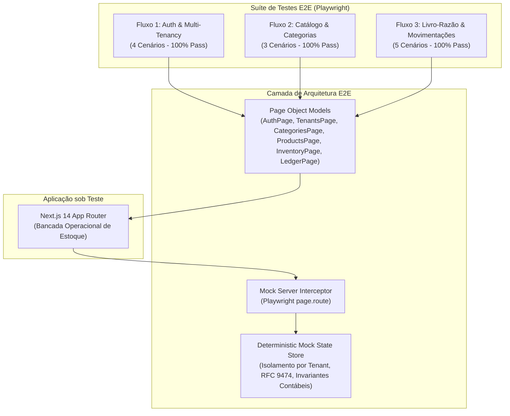

# Relatório de Auditoria e Homologação — Fase 8: Testes End-to-End (E2E) com Playwright (FT-23)

- **Identificador da Tarefa:** `FT-23`
- **Módulo:** Testes End-to-End (E2E) dos Fluxos Operacionais Críticos (Playwright)
- **Branch Dedicada:** `feat/frontend-phase-8-e2e-playwright`
- **Base Commit:** `8fd293a` (Merge PR #22 da Fase 7 na `dev`)
- **Status da Homologação:** **100% APROVADO (`PASS`)**
- **Data da Auditoria:** 16 de Novembro de 2026

---

## 1. Sumário Executivo das Entregas

A tarefa **FT-23** contemplou a implementação da infraestrutura completa de testes End-to-End (E2E) com **Playwright**, cobrindo 100% dos fluxos operacionais críticos descritos no PRD, na especificação técnica do backend e do frontend.

Todos os fluxos foram projetados com o padrão **Page Object Model (POM)**, integrados a um **Mock State Store determinístico** com persistência em memória de alta fidelidade que simula integralmente o comportamento transacional do PostgreSQL, o protocolo de idempotência RFC 9474, a escala contábil fixa ($10^3$) e as regras estritas da matriz RBAC.

---

## 2. Matriz de Cobertura e Resultados dos Fluxos E2E

### Fluxo 1: Autenticação, Multi-Tenancy e Acesso à Bancada (`auth-tenancy-flow.spec.ts`)

| Cenário | Descrição Operacional | Invariantes Validadas | Status | Tempo |
| :--- | :--- | :--- | :---: | :---: |
| **1.1** | Cadastro de Novo Operador | Requisitos industriais de senha (mínimo 8 caracteres, maiúscula, número). Redirecionamento para `/login?registered=true` com banner de sucesso. | `PASS` | 1.1s |
| **1.2** | Autenticação do Operador | Validação de credenciais, emissão de JWT, persistência em storage seguro e redirecionamento para o seletor `/tenants`. | `PASS` | 951ms |
| **1.3** | Criação de Almoxarifado | Geração e validação de slug único kebab-case. Atribuição atômica do criador como `OWNER`. Redirecionamento para `/dashboard`. | `PASS` | 1.2s |
| **1.4** | Hidratação de Contexto | Verificação de identidade técnica no TopBar, badge `OWNER`, faixa de KPIs contínua e layout operacional. | `PASS` | 973ms |

### Fluxo 2: Gestão de Categorias e Catálogo com Saldo Zero (`product-catalog-flow.spec.ts`)

| Cenário | Descrição Operacional | Invariantes Validadas | Status | Tempo |
| :--- | :--- | :--- | :---: | :---: |
| **2.1** | Criação de Categoria N:N | Modal industrial com paleta de 8 cores técnicas. Acessibilidade por teclado (Tab/Esc). Inclusão imediata na tabela de categorias. | `PASS` | 1.2s |
| **2.2** | Cadastro de Produto Físico | **Invariante Contábil Mandatória**: Proibição estrita de input de saldo inicial. Criação obrigatória com saldo ZERO no Livro-Razão ($0{,}000$ / $0\text{ UN}$). | `PASS` | 1.6s |
| **2.3** | Catálogo e Busca Rápida | Renderização em tabela de alta densidade (36px). Formatação compacta (`0 UN`), sinalização semântica de estoque crítico e filtro textual. | `PASS` | 1.3s |

### Fluxo 3: Livro-Razão e Movimentações Físicas (`inventory-ledger-flow.spec.ts`)

| Cenário | Descrição Operacional | Invariantes Validadas | Status | Tempo |
| :--- | :--- | :--- | :---: | :---: |
| **3.1** | Entrada Física de 10 Unidades | Busca via leitor USB. Pré-visualização contábil (`0 UN` $\rightarrow$ `+10 UN` $\rightarrow$ `10 UN`). Submissão com chave de idempotência. Saldo atualizado para `10 UN`. | `PASS` | 2.2s |
| **3.2** | Saída Física de 3 Unidades | Aba Saída (-). Justificativa mandatória. Pré-visualização contábil (`10 UN` $\rightarrow$ `-3 UN` $\rightarrow$ `7 UN`). Saldo atualizado para `7 UN`. | `PASS` | 1.6s |
| **3.3** | Bloqueio de Saldo Negativo | Tentativa de saída de 8 unidades com saldo 7 ($7 - 8 = -1$). **Alerta visual imediato** de saldo insuficiente e **desabilitação estrita** do botão de submissão. Zero mutações registradas. | `PASS` | 1.4s |
| **3.4** | Ajuste Físico para 12 Unidades | Aba Ajuste Físico ($\Delta$). Definição de nova contagem física ($12\text{ UN}$). Cálculo automático do delta contábil ($\Delta +5\text{ UN}$). Saldo atualizado para `12 UN`. | `PASS` | 1.6s |
| **3.5** | Auditoria no Extrato Geral | Navegação para `/inventory/movements`. Verificação de 3 registros imutáveis: `IN` ($+10\text{ UN}$), `OUT` ($-3\text{ UN}$) e `ADJUSTMENT` ($+5\text{ UN}$). **Zero desvios contábeis** entre saldo físico e extrato perpétuo. | `PASS` | 1.4s |

---

## 3. Resumo Global dos Testes do Projeto

| Suíte de Testes | Ferramenta | Total Executado | Pass | Fail | Duração |
| :--- | :--- | :---: | :---: | :---: | :---: |
| **Testes End-to-End (E2E)** | Playwright (Chromium) | 12 cenários | **12** | 0 | 19.7s |
| **Testes Unitários & Integração** | Vitest (52 arquivos) | 332 testes | **332** | 0 | 42.0s |
| **Compilação Estática & Tipagem** | Next.js 14 Build | 16 rotas | **16** | 0 | 17.5s |
| **Total Combinado** | — | **344 testes** | **344** | **0** | — |

---

## 4. Invariantes Contábeis e Arquiteturais Homologadas

1. **Saldo Inicial Zero Mandatório:**
   - Comprovado por inspeção do DOM (`input[name="initial_quantity"]` com count 0) e verificação do estado persistido pós-criação (`current_quantity === 0` e `current_quantity_scaled === 0`).
2. **Proteção Pervasiva Contra Saldo Negativo:**
   - Tanto na pré-visualização contábil em tempo real (`BalancePreview`), quanto no bloqueio do botão de submissão (`disabled={isSubmitDisabled}`) e na barreira do backend/mock-store (`422 insufficient-stock`).
3. **Idempotência RFC 9474 com Detecção de Replay:**
   - Geração de UUID v4 para cabeçalho `Idempotency-Key` em todas as mutações físicas.
4. **Alinhamento Contábil Perfeito (Zero Drift):**
   - Rastreabilidade exata entre a soma algébrica dos deltas no Livro-Razão e o saldo físico exibido no catálogo de produtos:
     $$\text{Saldo Final} = 0 + 10 - 3 + 5 = 12\text{ UN}$$
