# PRD - Task: Módulo de Autenticação e Multi-Tenancy (Auth & Multi-Tenant Isolation)

---

## 1. Identificação da Tarefa
- **Identificador:** `TASK-AUTH-TENANCY` (ou `TASK-02`)
- **Nome:** Módulo de Autenticação, Controle de Acesso Baseado em Papéis (RBAC) e Isolamento Estrito Multi-Tenant
- **Escopo:** Autenticação JWT OAuth2, Criptografia de Credenciais, Gestão de Organizações/Almoxarifados (Tenants), Associação N:N de Membros, Middleware/Dependency de Contexto de Tenant (`X-Tenant-ID`), RBAC e Migração de Esquema Alembic.
- **Responsável:** `code_implementer` (supervisionado por `orchestrator`)
- **Status:** Planejada / Pronta para Execução (Depende da Task 1)
- **Requisito Mandatório de Qualidade:** **Cobertura de testes unitários e de integração $\ge 80\%$** aferida via `pytest-cov` (`--cov-fail-under=80`).

---

## 2. Contexto e Justificativa de Engenharia

O sistema de gestão de estoque quantitativo evoluiu de uma instância mono-organização para uma arquitetura **SaaS B2B Multi-Tenant**. Em ambientes industriais e corporativos, múltiplos almoxarifados, subsidiárias ou empresas parceiras compartilham a mesma infraestrutura física de nuvem, mas exigem:

1. **Isolamento Lógico Absoluto:** Nenhum tenant pode ter visibilidade ou acesso a produtos, categorias, movimentações de estoque ou registros de auditoria de outro tenant (*data leakage prevention*).
2. **Identidade Centralizada e Flexibilidade Organizacional:** Um usuário (profissional de logística ou auditor externo) possui uma única identidade cadastral (email único) e pode prestar serviços a múltiplos almoxarifados ou empresas (relação N:N), exercendo papéis distintos em cada um (ex: `OWNER` na sua empresa, `AUDITOR` em outra).
3. **Criação Autônoma e Governança:** Qualquer usuário autenticado pode criar um novo tenant, tornando-se instantaneamente seu `OWNER` com prerrogativas totais de administração e delegação de membros.
4. **Segurança Criptográfica Padrão da Indústria:** Armazenamento seguro de senhas utilizando algoritmos de derivação de chave resistentes a ataques de GPU/dicionário (**bcrypt** / **argon2**) e emissão de tokens de acesso stateless via **JSON Web Tokens (JWT - RFC 7519)** sob fluxo **OAuth2 Password Bearer**.
5. **Contexto Mandatório por Requisição:** Cada requisição a endpoints de recursos de domínio deve carregar o identificador explícito do tenant ativo (cabeçalho HTTP `X-Tenant-ID`), validado atomicamente contra as associações permitidas do usuário logado antes de tocar na camada de negócios.

---

## 3. Modelo de Domínio e Arquitetura de Dados (PostgreSQL 16)

### 3.1. Diagrama Entidade-Relacionamento (ERD - Foco em Autenticação e Tenancy)

```mermaid
erDiagram
    USERS ||--o{ TENANT_MEMBERSHIPS : "participa como membro"
    TENANTS ||--o{ TENANT_MEMBERSHIPS : "possui membros"
    TENANTS ||--o{ PRODUCTS : "isola catalogo"
    TENANTS ||--o{ CATEGORIES : "isola categorias"
    TENANTS ||--o{ STOCK_MOVEMENTS : "isola lancamentos ledger"
    TENANTS ||--o{ IDEMPOTENCY_RECORDS : "isola chaves de requisicao"

    USERS {
        uuid id PK "Identificador único do usuário"
        varchar email UK "Email único de login"
        varchar password_hash "Hash criptografado da senha (bcrypt)"
        varchar full_name "Nome completo do usuário"
        boolean is_active "Status de ativação da conta"
        timestamptz created_at "Data/hora UTC de criação"
        timestamptz updated_at "Data/hora UTC da última alteração"
    }

    TENANTS {
        uuid id PK "Identificador único da organização/tenant"
        varchar name "Razão Social ou Nome do Almoxarifado"
        varchar slug UK "Identificador amigável único (ex: almoxarifado-central)"
        text description "Finalidade operacional do tenant"
        boolean is_active "Status de operação do tenant"
        timestamptz created_at "Data/hora UTC de criação"
        timestamptz updated_at "Data/hora UTC da última alteração"
    }

    TENANT_MEMBERSHIPS {
        uuid user_id PK,FK "Referência ao usuário (ON DELETE CASCADE)"
        uuid tenant_id PK,FK "Referência ao tenant (ON DELETE CASCADE)"
        varchar role "Papel no tenant: OWNER, GESTOR, ALMOXARIFE, AUDITOR"
        timestamptz created_at "Data/hora UTC de admissão"
        timestamptz updated_at "Data/hora UTC da alteração de papel"
    }

    CATEGORIES {
        uuid id PK "Identificador da categoria"
        uuid tenant_id FK "Isolamento por tenant (ON DELETE RESTRICT)"
        varchar name "Nome da categoria (único por tenant)"
        text description "Descrição do agrupamento"
        varchar color "Código de cor hex"
        timestamptz created_at "Data/hora UTC"
    }

    PRODUCTS {
        uuid id PK "Identificador do produto"
        uuid tenant_id FK "Isolamento por tenant (ON DELETE RESTRICT)"
        varchar name "Nome do produto físico"
        text description "Detalhes técnicos"
        varchar unit "UOM (UN, KG, etc.)"
        bigint current_quantity "Saldo atual em escala x1000"
        bigint min_stock "Estoque mínimo em escala x1000"
        boolean is_active "Indicador de disponibilidade"
        timestamptz created_at "Data/hora UTC"
        timestamptz updated_at "Data/hora UTC"
        timestamptz deleted_at "Data/hora UTC de soft-delete"
    }

    STOCK_MOVEMENTS {
        uuid id PK "Identificador do evento no Ledger"
        uuid tenant_id FK "Isolamento contábil por tenant (ON DELETE RESTRICT)"
        uuid product_id FK "Referência ao produto (ON DELETE RESTRICT)"
        varchar type "IN, OUT, ADJUSTMENT, PRODUCT_DELETED"
        bigint quantity "Delta físico em escala x1000"
        bigint balance_after "Saldo resultante em escala x1000"
        text reason "Motivo descritivo do lançamento"
        varchar idempotency_key "Chave de idempotência"
        timestamptz created_at "Data/hora UTC"
    }

    IDEMPOTENCY_RECORDS {
        varchar key PK "Chave de idempotência única"
        uuid tenant_id FK "Isolamento por tenant (ON DELETE CASCADE)"
        varchar request_hash "SHA-256 do payload normalizado"
        varchar endpoint "Caminho da rota mutatória"
        varchar status "PROCESSING, COMPLETED, FAILED"
        integer response_code "Status HTTP retornado"
        text response_body "Corpo JSON em cache"
        timestamptz created_at "Data/hora UTC"
        timestamptz updated_at "Data/hora UTC"
    }
```



---

## 4. Matriz de Autorização e Papéis (RBAC por Tenant)

O controle de acesso é estritamente contextualizado ao `tenant_id` ativo na requisição. Um usuário pode ter diferentes papéis em diferentes tenants:

| Operação / Capacidade | `OWNER` | `GESTOR` | `ALMOXARIFE` | `AUDITOR` |
| :--- | :---: | :---: | :---: | :---: |
| Atualizar dados cadastrais do Tenant | **SIM** | NÃO | NÃO | NÃO |
| Convidar/adicionar membro ao Tenant | **SIM** | **SIM** (apenas Almoxarife/Auditor) | NÃO | NÃO |
| Alterar papel ou remover membro do Tenant | **SIM** | NÃO | NÃO | NÃO |
| Criar e editar Categorias e Produtos | **SIM** | **SIM** | NÃO | NÃO |
| Inativar Produto (Soft-Delete com evento contábil) | **SIM** | **SIM** | NÃO | NÃO |
| Registrar Entrada física (`POST /api/inventory/in`) | **SIM** | **SIM** | **SIM** | NÃO |
| Registrar Saída física (`POST /api/inventory/out`) | **SIM** | **SIM** | **SIM** | NÃO |
| Registrar Ajuste de Inventário (`POST /api/inventory/adjustment`) | **SIM** | **SIM** | **SIM** | **SIM** |
| Consultar Catálogo e Saldos (`GET /api/products`) | **SIM** | **SIM** | **SIM** | **SIM** |
| Consultar Extrato do Ledger (`GET /api/inventory/movements`) | **SIM** | **SIM** | **SIM** | **SIM** |

---

## 5. Requisitos Funcionais Detalhados

### 5.1. RF-01: Cadastro e Registro de Usuários
- **Endpoint:** `POST /api/auth/register` (Público)
- **Regras de Negócio:**
  - O email fornecido deve ser normalizado para letras minúsculas (`email.strip().lower()`) e validado quanto à sintaxe de email RFC 5322.
  - O email deve ser globalmente único no sistema. Caso já exista, retornar `HTTP 409 Conflict` (padrão RFC 7807).
  - A senha em texto puro deve ter comprimento mínimo de 8 caracteres, contendo pelo menos um número e uma letra maiúscula.
  - A senha é criptografada utilizando algoritmo de hash seguro via `passlib[bcrypt]` com fator de trabalho (*rounds*) padrão mínimo de 12.
  - O usuário é criado com `is_active = True`.
- **Response:** `201 Created` contendo dados cadastrais sem exposição do hash de senha.

### 5.2. RF-02: Autenticação e Emissão de Token JWT
- **Endpoint:** `POST /api/auth/login` (Público)
- **Entrada:** Suporte a dados via formulário padrão OAuth2 (`OAuth2PasswordRequestForm`: `username` e `password`) e/ou JSON (`email` e `password`).
- **Regras de Negócio:**
  - O usuário é localizado pelo email normalizado.
  - Se o usuário não existir ou se `is_active == False`, retornar `HTTP 401 Unauthorized`.
  - A senha fornecida é verificada via `pwd_context.verify(password, user.password_hash)`.
  - Se a senha estiver incorreta, retornar `HTTP 401 Unauthorized` com mensagem genérica *"Credenciais inválidas"*, mitigando enumeração de usuários.
  - Se válida, gerar um token JWT assinado digitalmente com `HS256` contendo os claims:
    - `sub`: ID do usuário (string UUID).
    - `email`: email do usuário.
    - `exp`: data/hora UTC de expiração (calculada a partir de `ACCESS_TOKEN_EXPIRE_MINUTES`).
    - `iat`: data/hora UTC de emissão.
    - `type`: `"access"`.
- **Response:** `200 OK` com `access_token`, `token_type = "bearer"` e `expires_in` (em segundos).

### 5.3. RF-03: Consulta do Usuário Autenticado (`/api/auth/me`)
- **Endpoint:** `GET /api/auth/me` (Protegido por Bearer Token)
- **Regras de Negócio:**
  - Valida o token JWT recebido no cabeçalho `Authorization: Bearer <token>`.
  - Retorna o perfil cadastral do usuário e a lista detalhada de **todos os tenants** aos quais ele pertence, informando para cada um: `tenant_id`, `tenant_name`, `tenant_slug` e o seu papel (`role`).

### 5.4. RF-04: Criação e Gestão de Organizações (Tenants)
- **Endpoint:** `POST /api/tenants` (Protegido por Bearer Token)
- **Entrada:** `name: str`, `slug: str` (opcional; se omitido, gerado a partir do nome), `description: Optional[str]`.
- **Regras de Negócio:**
  - Apenas usuários autenticados podem invocar este endpoint.
  - O `slug` deve ser alfanumérico com hifens (kebab-case) e globalmente único na tabela `tenants`. Em caso de colisão, retornar `HTTP 409 Conflict`.
  - **Atomicidade Transacional:** A criação do tenant e a atribuição do usuário criador como membro com papel `OWNER` ocorrem dentro da mesma transação do banco de dados.
- **Response:** `201 Created` com os detalhes do tenant e a confirmação do papel `OWNER`.

### 5.5. RF-05: Listagem e Gestão de Membros do Tenant
- **Listar Membros:** `GET /api/tenants/{tenant_id}/members` (Requer autenticação e ser membro do tenant). Retorna lista com `user_id`, `email`, `full_name`, `role` e `joined_at`.
- **Adicionar Membro:** `POST /api/tenants/{tenant_id}/members` (Requer role `OWNER` ou `GESTOR`).
  - Entrada: `email: EmailStr`, `role: TenantRole`.
  - Localiza o usuário pelo email. Se não existir, retorna `HTTP 404 Not Found`.
  - Verifica se o usuário já é membro do tenant. Se sim, retorna `HTTP 409 Conflict`.
  - Insere a associação em `tenant_memberships`.
- **Alterar Papel de Membro:** `PUT /api/tenants/{tenant_id}/members/{user_id}` (Requer role `OWNER`).
  - Impede que o último `OWNER` altere seu próprio papel caso não existam outros `OWNER`s ativos no tenant (`HTTP 422 Unprocessable Entity`).
- **Remover Membro:** `DELETE /api/tenants/{tenant_id}/members/{user_id}` (Requer role `OWNER`).
  - Impede que o único `OWNER` se auto-remova do tenant.

### 5.6. RF-06: Middleware / Dependency de Contexto de Tenant (`TenantContext`)
- **Cabeçalho Obrigatório:** Em todas as rotas mutatórias e de consulta de Catálogo, Estoque e Idempotência:
  `X-Tenant-ID: <UUID>`
- **Fluxo da Injeção de Dependência (`get_tenant_context`):**
  1. Extrai o usuário autenticado via `get_current_user` (Bearer JWT).
  2. Extrai o cabeçalho `X-Tenant-ID`. Se ausente ou com formato de UUID inválido, levanta `HTTP 400 Bad Request` ou `401 Unauthorized`.
  3. Consulta no banco de dados se o `tenant_id` existe e está ativo. Se inexistente/inativo, responde `HTTP 404 Not Found`.
  4. Consulta a tabela `tenant_memberships` para verificar se `(user_id, tenant_id)` existe.
  5. Se o usuário **não pertencer** àquele tenant, rejeita imediatamente com `HTTP 403 Forbidden` (`TenantAccessDeniedError`), detalhando que o usuário autenticado não tem outorga sobre aquele tenant.
  6. Se válido, instancia o objeto `TenantContext(tenant=tenant, user=user, role=membership.role)` e injeta no Use Case.

### 5.7. RF-07: Isolamento Estrito nas Consultas de Domínio
- **Repositórios e Consultas:**
  - Toda cláusula `SELECT`, `UPDATE` ou `INSERT` nos módulos de `products`, `categories`, `inventory` e `idempotency` **DEVE** incluir obrigatoriamente a condição:
    `WHERE tenant_id = :current_tenant_id`
  - Bloqueios pessimistas (`with_for_update()`) para movimentação de estoque devem verificar simultaneamente `product.id == product_id` e `product.tenant_id == current_tenant_id`.
  - Operações de Idempotência filtram por `(tenant_id, key)`. Dois tenants podem utilizar a chave `"req-001"` simultaneamente sem que ocorra colisão de cache ou colisão de unicidade.

---

## 6. Modelos ORM SQLAlchemy Detalhados

### 6.1. Modelos de Autenticação e Tenancy (`backend/app/modules/auth/infrastructure/models.py`)

```python
import uuid
from datetime import datetime, timezone
from enum import Enum
from sqlalchemy import (
    Column, String, Boolean, DateTime, Text, ForeignKey,
    UniqueConstraint, Index
)
from sqlalchemy.dialects.postgresql import UUID
from sqlalchemy.orm import relationship
from app.shared.infrastructure.database import Base


def utc_now():
    return datetime.now(timezone.utc)


class TenantRole(str, Enum):
    OWNER = "OWNER"
    GESTOR = "GESTOR"
    ALMOXARIFE = "ALMOXARIFE"
    AUDITOR = "AUDITOR"


class UserModel(Base):
    __tablename__ = "users"

    id = Column(UUID(as_uuid=True), primary_key=True, default=uuid.uuid4)
    email = Column(String(255), unique=True, nullable=False, index=True)
    password_hash = Column(String(255), nullable=False)
    full_name = Column(String(255), nullable=False)
    is_active = Column(Boolean, nullable=False, default=True)
    created_at = Column(DateTime(timezone=True), nullable=False, default=utc_now)
    updated_at = Column(DateTime(timezone=True), nullable=False, default=utc_now, onupdate=utc_now)

    memberships = relationship(
        "TenantMembershipModel",
        back_populates="user",
        cascade="all, delete-orphan",
        passive_deletes=True
    )


class TenantModel(Base):
    __tablename__ = "tenants"

    id = Column(UUID(as_uuid=True), primary_key=True, default=uuid.uuid4)
    name = Column(String(255), nullable=False)
    slug = Column(String(100), unique=True, nullable=False, index=True)
    description = Column(Text, nullable=True)
    is_active = Column(Boolean, nullable=False, default=True)
    created_at = Column(DateTime(timezone=True), nullable=False, default=utc_now)
    updated_at = Column(DateTime(timezone=True), nullable=False, default=utc_now, onupdate=utc_now)

    memberships = relationship(
        "TenantMembershipModel",
        back_populates="tenant",
        cascade="all, delete-orphan",
        passive_deletes=True
    )


class TenantMembershipModel(Base):
    __tablename__ = "tenant_memberships"

    user_id = Column(
        UUID(as_uuid=True),
        ForeignKey("users.id", ondelete="CASCADE"),
        primary_key=True
    )
    tenant_id = Column(
        UUID(as_uuid=True),
        ForeignKey("tenants.id", ondelete="CASCADE"),
        primary_key=True
    )
    role = Column(String(32), nullable=False, default=TenantRole.ALMOXARIFE.value)
    created_at = Column(DateTime(timezone=True), nullable=False, default=utc_now)
    updated_at = Column(DateTime(timezone=True), nullable=False, default=utc_now, onupdate=utc_now)

    user = relationship("UserModel", back_populates="memberships")
    tenant = relationship("TenantModel", back_populates="memberships")

    __table_args__ = (
        Index("ix_tenant_memberships_tenant_user", "tenant_id", "user_id"),
    )
```

### 6.2. Atualização dos Modelos de Domínio com `tenant_id`

- **`categories`:**
  ```python
  tenant_id = Column(UUID(as_uuid=True), ForeignKey("tenants.id", ondelete="RESTRICT"), nullable=False, index=True)
  # Restrição de unicidade composta por tenant:
  __table_args__ = (
      UniqueConstraint("tenant_id", "name", name="uq_categories_tenant_name"),
  )
  ```
- **`products`:**
  ```python
  tenant_id = Column(UUID(as_uuid=True), ForeignKey("tenants.id", ondelete="RESTRICT"), nullable=False, index=True)
  __table_args__ = (
      Index("ix_products_tenant_active", "tenant_id", "is_active"),
  )
  ```
- **`stock_movements`:**
  ```python
  tenant_id = Column(UUID(as_uuid=True), ForeignKey("tenants.id", ondelete="RESTRICT"), nullable=False, index=True)
  __table_args__ = (
      Index("ix_stock_movements_tenant_created", "tenant_id", "created_at"),
  )
  ```
- **`idempotency_records`:**
  ```python
  tenant_id = Column(UUID(as_uuid=True), ForeignKey("tenants.id", ondelete="CASCADE"), nullable=False, index=True)
  # Chave primária ou unicidade composta:
  __table_args__ = (
      UniqueConstraint("tenant_id", "key", name="uq_idempotency_tenant_key"),
  )
  ```

---

## 7. Contratos DTOs (Pydantic v2)

```python
from pydantic import BaseModel, EmailStr, Field
from typing import Optional, List
from uuid import UUID
from datetime import datetime
from enum import Enum


class TenantRoleEnum(str, Enum):
    OWNER = "OWNER"
    GESTOR = "GESTOR"
    ALMOXARIFE = "ALMOXARIFE"
    AUDITOR = "AUDITOR"


# --- Autenticação ---
class UserRegisterRequest(BaseModel):
    email: EmailStr
    password: str = Field(..., min_length=8, description="Senha com no mínimo 8 caracteres")
    full_name: str = Field(..., min_length=2, max_length=255)


class UserResponse(BaseModel):
    id: UUID
    email: EmailStr
    full_name: str
    is_active: bool
    created_at: datetime


class LoginRequest(BaseModel):
    email: EmailStr
    password: str


class TokenResponse(BaseModel):
    access_token: str
    token_type: str = "bearer"
    expires_in: int


class TenantBriefResponse(BaseModel):
    tenant_id: UUID
    tenant_name: str
    tenant_slug: str
    role: TenantRoleEnum


class UserProfileResponse(BaseModel):
    id: UUID
    email: EmailStr
    full_name: str
    is_active: bool
    tenants: List[TenantBriefResponse]


# --- Tenants ---
class TenantCreateRequest(BaseModel):
    name: str = Field(..., min_length=2, max_length=255)
    slug: Optional[str] = Field(None, min_length=2, max_length=100, pattern=r"^[a-z0-9-]+$")
    description: Optional[str] = None


class TenantResponse(BaseModel):
    id: UUID
    name: str
    slug: str
    description: Optional[str]
    is_active: bool
    created_at: datetime
    updated_at: datetime


class TenantMemberAddRequest(BaseModel):
    email: EmailStr
    role: TenantRoleEnum = TenantRoleEnum.ALMOXARIFE


class TenantMemberResponse(BaseModel):
    user_id: UUID
    email: EmailStr
    full_name: str
    role: TenantRoleEnum
    joined_at: datetime
```

---

## 8. Endpoints da API RESTful

### 8.1. `POST /api/auth/register`
- **Acesso:** Público
- **Request Body:**
  ```json
  {
    "email": "almoxarife.chefe@empresa.com",
    "password": "SenhaSegura123",
    "full_name": "Carlos Eduardo Silva"
  }
  ```
- **Response `201 Created`:**
  ```json
  {
    "id": "e4b6c3d2-a1f0-4b8c-9d3e-7a2b1c0d9e8f",
    "email": "almoxarife.chefe@empresa.com",
    "full_name": "Carlos Eduardo Silva",
    "is_active": true,
    "created_at": "2026-11-10T18:00:00Z"
  }
  ```

### 8.2. `POST /api/auth/login`
- **Acesso:** Público
- **Request Body:**
  ```json
  {
    "email": "almoxarife.chefe@empresa.com",
    "password": "SenhaSegura123"
  }
  ```
- **Response `200 OK`:**
  ```json
  {
    "access_token": "eyJhbGciOiJIUzI1NiIsInR5cCI6IkpXVCJ9...",
    "token_type": "bearer",
    "expires_in": 3600
  }
  ```

### 8.3. `GET /api/auth/me`
- **Headers:** `Authorization: Bearer <token>`
- **Response `200 OK`:**
  ```json
  {
    "id": "e4b6c3d2-a1f0-4b8c-9d3e-7a2b1c0d9e8f",
    "email": "almoxarife.chefe@empresa.com",
    "full_name": "Carlos Eduardo Silva",
    "is_active": true,
    "tenants": [
      {
        "tenant_id": "99ee2005-115d-c7e1-88aa-b1c2d3e4f5a6",
        "tenant_name": "Almoxarifado Central Matriz",
        "tenant_slug": "matriz-central",
        "role": "OWNER"
      },
      {
        "tenant_id": "11aa3344-55bb-66cc-77dd-88ee99ff00aa",
        "tenant_name": "Filial Sul - Depósito Logístico",
        "tenant_slug": "filial-sul",
        "role": "AUDITOR"
      }
    ]
  }
  ```

### 8.4. `POST /api/tenants`
- **Headers:** `Authorization: Bearer <token>`
- **Request Body:**
  ```json
  {
    "name": "Almoxarifado Central Matriz",
    "slug": "matriz-central",
    "description": "Depósito principal de matérias-primas e insumos industriais"
  }
  ```
- **Response `201 Created`:**
  ```json
  {
    "id": "99ee2005-115d-c7e1-88aa-b1c2d3e4f5a6",
    "name": "Almoxarifado Central Matriz",
    "slug": "matriz-central",
    "description": "Depósito principal de matérias-primas e insumos industriais",
    "is_active": true,
    "created_at": "2026-11-10T18:05:00Z",
    "updated_at": "2026-11-10T18:05:00Z"
  }
  ```

### 8.5. `GET /api/tenants`
- **Headers:** `Authorization: Bearer <token>`
- **Response `200 OK`:** Lista de todos os tenants em que o usuário possui vínculo ativo.

### 8.6. `POST /api/tenants/{tenant_id}/members`
- **Headers:** `Authorization: Bearer <token>`, `X-Tenant-ID: <UUID>`
- **Permissão Mínima:** `OWNER` ou `GESTOR`
- **Request Body:**
  ```json
  {
    "email": "operador.joao@empresa.com",
    "role": "ALMOXARIFE"
  }
  ```
- **Response `201 Created`:**
  ```json
  {
    "user_id": "a1b2c3d4-e5f6-7a8b-9c0d-1e2f3a4b5c6d",
    "email": "operador.joao@empresa.com",
    "full_name": "João Pereira",
    "role": "ALMOXARIFE",
    "joined_at": "2026-11-10T18:10:00Z"
  }
  ```

---

## 9. Tratamento de Erros e Padrão RFC 7807

Todas as falhas de autenticação, permissão ou escopo de tenant emitem payload padronizado RFC 7807:

```json
{
  "type": "https://api.estoque.local/errors/tenant-access-denied",
  "title": "Acesso Negado ao Tenant",
  "status": 403,
  "detail": "O usuário autenticado não possui vínculo ativo com a organização solicitada (ID: 99ee2005-115d-c7e1-88aa-b1c2d3e4f5a6).",
  "instance": "/api/products"
}
```

### Catálogo de Erros de Auth & Tenancy:
- **`400 Bad Request` (`missing-tenant-header`):** Cabeçalho `X-Tenant-ID` ausente em rota protegida que exige escopo de tenant.
- **`401 Unauthorized` (`invalid-credentials`):** Email ou senha incorretos.
- **`401 Unauthorized` (`token-expired`):** Token JWT expirou.
- **`401 Unauthorized` (`invalid-token`):** Assinatura ou estrutura de token JWT corrompida.
- **`403 Forbidden` (`tenant-access-denied`):** Usuário não pertence ao tenant informado.
- **`403 Forbidden` (`insufficient-permissions`):** Papel do usuário no tenant não autoriza a operação (ex: `ALMOXARIFE` tentando deletar produto).
- **`404 Not Found` (`tenant-not-found`):** O ID de tenant especificado não existe ou está inativado.
- **`404 Not Found` (`user-not-found`):** Email informado para inclusão de membro não corresponde a um usuário registrado.
- **`409 Conflict` (`email-already-exists`):** Email já registrado por outro usuário.
- **`409 Conflict` (`tenant-slug-already-exists`):** Slug de tenant já em uso.
- **`409 Conflict` (`member-already-exists`):** Usuário já é membro daquele tenant.
- **`422 Unprocessable Entity` (`sole-owner-removal`):** Tentativa de remover ou rebaixar o único `OWNER` remanescente do tenant.

---

## 10. Plano de Migração com Alembic (`0002_add_auth_and_multi_tenancy.py`)

A evolução do banco deve ser implementada em nova revisão do Alembic:
1. `op.create_table('users', ...)` com constraint de email único e índices.
2. `op.create_table('tenants', ...)` com constraint de slug único e índices.
3. `op.create_table('tenant_memberships', ...)` com PK composta `(user_id, tenant_id)` e FKs `CASCADE`.
4. `op.add_column('categories', sa.Column('tenant_id', sa.UUID(), nullable=True))`
5. `op.add_column('products', sa.Column('tenant_id', sa.UUID(), nullable=True))`
6. `op.add_column('stock_movements', sa.Column('tenant_id', sa.UUID(), nullable=True))`
7. `op.add_column('idempotency_records', sa.Column('tenant_id', sa.UUID(), nullable=True))`
8. *Para bases com dados existentes:* Criação de um tenant default de migração (`slug='default'`), atualização de `tenant_id` dos registros legados para esse tenant default, e subsequente aplicação de `nullable=False` e `ForeignKeyConstraint` com `ON DELETE RESTRICT`.
9. Atualização das constraints de unicidade de `categories` de global para composta: `UniqueConstraint('tenant_id', 'name')`.
10. Teste estrito de reversibilidade com `alembic downgrade -1` e `alembic upgrade head`.

---

## 11. Requisito de Cobertura de Testes ($\ge 80\%$)

### 11.1. Meta de Cobertura
- A cobertura de testes automatizados do novo módulo `app/modules/auth/` e `app/modules/tenants/` deve atingir **no mínimo 80%** de linhas e branches executados via `pytest-cov`.

### 11.2. Casos de Teste Obrigatórios
1. **`test_user_registration_success`:** Registro de novo usuário com hash verificado via `verify()`.
2. **`test_user_registration_duplicate_email`:** Rejeição de email repetido com status HTTP 409.
3. **`test_login_success_and_jwt_claims`:** Login com credenciais válidas; decodificação e validação dos claims do JWT (`sub`, `exp`, `email`).
4. **`test_login_invalid_password`:** Rejeição de senha errada com status HTTP 401.
5. **`test_tenant_creation_assigns_owner`:** Criação de novo tenant assegurando atomicamente que o criador é inserido como `OWNER` em `tenant_memberships`.
6. **`test_tenant_membership_cross_tenant_isolation`:**
   - Criar Usuário 1 (membro do Tenant A) e Usuário 2 (membro do Tenant B).
   - Usuário 1 tenta acessar endpoint com header `X-Tenant-ID: <Tenant B>`.
   - Validar retorno mandatório `HTTP 403 Forbidden` (`tenant-access-denied`).
7. **`test_rbac_role_enforcement`:**
   - Usuário com role `ALMOXARIFE` tenta cadastrar produto no Tenant A -> Rejeitado com `HTTP 403 Forbidden`.
   - Usuário com role `GESTOR` tenta cadastrar produto no Tenant A -> Autorizado com `HTTP 201 Created`.
8. **`test_data_isolation_between_tenants`:**
   - Cadastrar Produto X no Tenant A e Produto Y no Tenant B.
   - Listar produtos com `X-Tenant-ID: <Tenant A>`: deve retornar **apenas** o Produto X.
   - O Produto Y não pode constar na lista em nenhuma hipótese.
9. **`test_idempotency_scoped_by_tenant`:**
   - Tenant A e Tenant B executam requisição com a **mesma chave de idempotência** `K1`.
   - Ambos devem processar suas requisições com sucesso sem conflito entre tenants.

---

## 12. Critérios de Aceitação (DoD - Definition of Done)

- [ ] Tabelas `users`, `tenants` e `tenant_memberships` criadas e integradas via migração Alembic.
- [ ] Coluna `tenant_id` adicionada e indexada em `categories`, `products`, `stock_movements` e `idempotency_records`.
- [ ] Endpoints de autenticação (`/api/auth/register`, `/api/auth/login`, `/api/auth/me`) implementados e protegidos.
- [ ] Endpoints de tenant (`/api/tenants`, `/api/tenants/{id}/members`) implementados com atribuição automática de `OWNER`.
- [ ] Dependência FastAPI `get_tenant_context` validando rigorosamente o cabeçalho `X-Tenant-ID` e a membership do usuário autenticado.
- [ ] Middleware / decorator de checagem de RBAC (`require_roles`) ativo e testado.
- [ ] Todos os testes unitários e de integração verdes contra PostgreSQL via Docker.
- [ ] Cobertura de testes $\ge 80\%$ confirmada no relatório do `pytest-cov`.
- [ ] Respostas de erro padronizadas integralmente sob RFC 7807.
